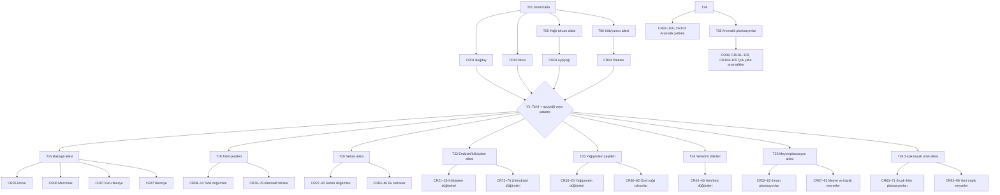

# Ekilebilir ürün ağacı ve takvim kataloğu — öneri 0.2

Bu belge, kullanıcının önceki kararlarını koruyarak ekilebilir ürün içeriğini genişletir ve teknoloji ağacıyla eşler. Katalog, **CR01–CR105 kodlu 105 ayrı mahsul düğümünden** oluşur. **Ürün aileleri, açılma sırası, mahsul başına teknoloji, ham satış alternatifi ve işleme fikirleri tasarım önerisidir;** sayısal oyun değerleri ilk denge hedefleridir. Gerçek tarım kaynakları takvim örüntülerine ve çeşitliliğe dayanak verir; oyunun dakika cinsinden çevrim süreleri gerçek günlerin birebir karşılığı değildir.

İlgili belgeler: [kapsamlı teknoloji ağacı](./technology-tree-comprehensive-proposal.md), [ekonomi ve ilerleme modeli](./economy-and-progression-proposal.md), [ürün takvimi modelinin ilk kaynaklı matrisi](./crop-calendar-model.md), [bölgesel çeşitlilik notları](./regional-crop-diversity.md).

## 1. Değişmez tasarım kuralları

1. Ürün teknolojisi açılmışsa o ürün **her iklim kuşağında ve iki yarımkürede** ekilebilir. Arazi veya iklim ürünü kilitlemez; ürün-parsel uygunluğu hasat miktarını yaklaşık **0,80–1,15** çarpanıyla değiştirir. Hedefli sulama/çeşit teknolojisi düşük uygunluğu kısmen iyileştirebilir, doğal avantajı tamamen silmez.
2. Oyunda dört temsilî iklim profili bulunur: Akdeniz, karasal, ılıman denizel ve nemli subtropikal. Her kuşakta tek ürün takvimi kullanılır. Güney Yarımküre'de mevsim evresi Kuzey'e göre **9 saat faz kayar**; bu, 18 saatlik yılı korur.
3. Yıl 18 saattir; ilk sürümde her mevsim 4,5 saattir. Ekim penceresi uygun mevsimin tamamıdır. Mevsim atlanırsa geç ekim verimi düşer. Hava olayı yoktur; mevsim etkisi önceden görülebilir.
4. Oyuncu her hasat partisini ham satışa veya açtığı fabrikaya ayrı ayrı yönlendirir. Ham satış hep açıktır. İşleme hammaddenin tam değerini ikinci kez saymaz; ömür boyu üretim sayacına yalnız katma değer ekler.
5. Teknoloji, ürünü ekme izni verir; tohum ve gerekli ekipman ayrıca satın alınır. Ürün ailesi teknolojisi ailedeki tüm mahsulleri topluca açmaz. Bir ürünün işleme hattı da ayrı teknoloji ve ayrıca satın alınan tesis ister.
6. Kısa çevrimli mevsimlik ürün aynı uygun ekim penceresi içinde birden fazla kez ekilebilir. Ürün büyümesi mevsimler arasında sürer. İzinli hasat dönemi bittiğinde tamamlanmayan yıllık çevrim, geçen büyüme süresi / tam büyüme süresi kadar kısmi ürün verir; kalan üretim kaybolur. Oyuncu, sezon tahminiyle bu riski önceden görebilir.
7. Çok yıllı bitkiler kalıcı plantasyon olarak kurulur. İlk kurulum/olgunlaşma uzun sürer; daha sonra izinli hasat penceresinde çevrim tamamlandıkça hasat verir. Dönem kapanırken son çevrim kısmi hasat verir; plantasyon kalır. Sera mevsimlik ürünlere yıl boyu çevrim açar, plantasyonun hasat mevsimini değiştirmez.
8. Hasat süresi ve hasat başına değer yeni teknoloji katmanlarıyla artar. Bu, bütün ürünlerin dakika başına aynı getiriyi vermesi gerektiği anlamına gelmez: kısa ürün nakit akışı, uzun ürün parsel başına büyük hasat, plantasyon ise kuruluş yatırımı karşılığında kalıcı tekrar hasadı sunar.
9. Toprak ayrı, basit bir 0–100 parsel durumudur. Hasatla hafifçe azalır; otomatik gübreleme uygun nakit olduğunda iyileştirir. Rotasyon farklı bir küçük bonus verir. Aynı mahsulü tekrar ekmeye ceza yoktur; toprak veya nakit sorunu üretimi tamamen kilitlemez.

## 2. Takvim gösterim anahtarı

Her ürün satırındaki `takvim` kodu, aşağıdaki temsilî **ekim → büyüme → son hasat** penceresini belirtir. Bunlar belirli bir ülkedeki tarih sözü değil, her iklim kuşağı için tek ve okunabilir oyun profilleridir.

| Kod | Ürün tipi | Akdeniz profili | Karasal profil | Ilıman denizel profil | Nemli subtropikal profil |
|---|---|---|---|---|---|
| K | Serin dönem yıllıkları: kışlık tahıl, baklagil, yapraklı | Sonbahar/kış ekimi → kış/ilkbahar büyümesi → ilkbahar/erken yaz hasadı | İlkbahar ekimi → ilkbahar/yaz büyümesi → yaz/erken sonbahar hasadı | İlkbahar veya sonbahar ekimi → serin dönem büyümesi → yaz/sonbahar hasadı | Sonbahar/kış ekimi → kış/ilkbahar büyümesi → ilkbahar hasadı |
| I | İlkbahar/yaz ılık dönem yıllıkları | İlkbahar ekimi → yaz büyümesi → yaz sonu/sonbahar hasadı | İlkbahar ekimi → yaz büyümesi → yaz sonu/sonbahar hasadı | Geç ilkbahar ekimi → yaz büyümesi → sonbahar hasadı | İlkbahar ekimi → yaz büyümesi → yaz sonu/sonbahar hasadı |
| U | Uzun çevrimli sıcak dönem ve şeker/endüstri ürünleri | İlkbahar ekimi → yaz/sonbahar büyümesi → sonbahar hasadı | İlkbahar ekimi → yaz/sonbahar büyümesi → sonbahar hasadı | Geç ilkbahar ekimi → yaz/sonbahar büyümesi → sonbahar hasadı | İlkbahar/yaz ekimi → sıcak dönem büyümesi → sonbahar/kış başı hasadı |
| R | Kök/yumru; ürün türüne göre serin veya ılık dönem | Sonbahar veya ilkbahar ekimi → kış/ilkbahar büyümesi → ilkbahar/yaz hasadı | İlkbahar ekimi → yaz büyümesi → yaz sonu/sonbahar hasadı | İlkbahar ekimi → serin/nemli büyüme → yaz/sonbahar hasadı | Sonbahar/kış ya da ilkbahar ekimi → ılık büyüme → ilkbahar/sonbahar hasadı |
| S | Çok yıllı, ılıman meyve/bağ/zeytin | Kalıcı dikim → kış/ilkbahar büyümesi → türe göre yaz/sonbahar hasadı | Kalıcı dikim → ilkbahar/yaz büyümesi → yaz sonu/sonbahar hasadı | Kalıcı dikim → ilkbahar/yaz büyümesi → yaz/sonbahar hasadı | Kalıcı dikim → yıl boyu gelişim → türe göre yaz/kış hasadı |
| T | Sıcak kuşak çok yıllı plantasyon | Kalıcı dikim → sıcak dönemde gelişim → yaz/sonbahar hasadı | Kalıcı dikim → kısa sıcak dönemde gelişim → yaz/sonbahar hasadı | Kalıcı dikim → ılık dönemde gelişim → yaz/sonbahar hasadı | Kalıcı dikim → uzun sıcak dönemde gelişim → bir veya birden fazla sezonluk hasat |

Ürünün bireysel penceresi, aile kodunun varsayılanını daraltabilir (ör. zeytin için sonbahar-kış, pirinç için sıcak dönem, muz için sürekli olgunlaşan hasat). CR01–CR04 için bu genel kısaltma yerine [ilk kaynaklı dört-ürün matrisi](./crop-calendar-model.md) önceliklidir. Pencere ve gelecek mevsim oyuncuya açık gösterilir. Oyuncu “ürün tüm kuşaklarda yetişir” kuralını korurken iklim başına ayrı bir yıllık takvim öğrenmek zorunda kalmaz. Güney Yarımküre takvimi aynı kodun 9 saat faz kaydırılmış halidir.

## 3. Ürün teknoloji ağacı

`CRxx` mahsul düğümüdür. Aile teknoloji düğümü yalnızca mahsul listesini görünür ve satın alınabilir yapar; her mahsul yine kendi ön koşul, kanıt ve para bedelini ister. Ürün düğümleri paralel açılabilir, hiçbir dal kalıcı uzmanlık kilidi değildir. İlk çeşitlilik kanıtı için ayçiçeği ve patates alternatifleri V1 öncesinde erişilebilir olmalıdır.

### Ürün ve dal kodlarının eski düğümlerle eşlemesi

| Mevcut ağaç düğümü | Bu katalogdaki ürün/dal |
|---|---|
| T01 | CR01 buğday ve CR02 mısırın temel ekim izni; başlangıç parseli ve ücretsiz ilk tohum korunur |
| T05 → T13 | Yağlı tohum ailesi → CR03 ayçiçeği |
| T06 → T14 | Kök/yumru ailesi → CR04 patates |
| T15 → T16/T17/T18 | Baklagil ailesi → CR05 nohut / CR06 mercimek / CR07 kuru fasulye |
| T19–T35 | Tahıl, sebze, yem, plantasyon, tropik ve aromatik aile kapıları; her CR ayrı mahsul düğümüdür |
| PR05 / PR06 / PR12 | CR03 ayçiçeği → yağ; CR04 patates → nişasta; CR05 nohut → un |

### A. Açılış ve ilk çeşitlilik — kullanıcı kararları korunur

| CR | Ürün / aile | Ön koşul ve kanıt | Takvim | Oyun çevrimi / 1.000 m² taban hasat hedefi | İlk isteğe bağlı işleme veya kullanım |
|---|---|---|---|---|---|
| CR01 | Buğday — tahıl | T01 başlangıç izni; ilk ücretsiz tohum | K | 5–10 dk; 1,0 BHB | PR13/PR04: un; kepek yan ürünü PR10 öncesi otomatik satılır |
| CR02 | Mısır — tahıl | T01 başlangıç izni; ilk ücretsiz tohum | I | 5–10 dk; 1,0 BHB | PR01: mısır unu; ileride nişasta/yem rotaları |
| CR03 | Ayçiçeği — yağlı tohum | T05 + P2/C2; tek mahsul izni; V1 alternatifi | I | 12–18 dk; 1,5–1,8 BHB | PR05: ayçiçek yağı; pres küspesi yan ürün |
| CR04 | Patates — kök/yumru | T06 + P2/C2; tek mahsul izni; V1 alternatifi | R | 12–18 dk; 1,5–1,8 BHB | PR06: nişasta; posa yan ürün |
| CR05 | Nohut — baklagil | T15 + P2/C2 + V1 sonrası; dalın ilk mahsulü | K | 20–24 dk; 2,2–2,5 BHB | PR12: nohut unu; ham nohut satışı hep açık |
| CR06 | Mercimek — baklagil | T21 + P3/C3 | K | 24–27 dk; 2,5–2,7 BHB | Tasnif/paketleme; ileride çorba/konserve |
| CR07 | Kuru fasulye — baklagil | T21 + P3/C3 | I | 27–30 dk; 2,7–3,0 BHB | Tasnif/paketleme; ileride konserve |

### B. Tahıllar — T19 Geniş tahıl ailesi

| CR | Ürün | Ön koşul / kanıt | Takvim | Çevrim / taban hasat | İşleme ve ek rol |
|---|---|---|---|---|---|
| CR08 | Arpa | T19 + P2/C2 | K | 22–26 dk; 2,3–2,6 BHB | Malt, inci arpa; saman/küspe yem |
| CR09 | Yulaf | T19 + P2/C2 | K | 24–28 dk; 2,4–2,8 BHB | Yulaf ezmesi/unu; saman yem |
| CR10 | Çavdar | T19 + P3/C3 | K | 27–30 dk; 2,7–3,0 BHB | Çavdar unu; saman yem |
| CR11 | Pirinç | T19 + uygun sulama/işleme opsiyonları + P3/C3 | I | 32–38 dk; 3,1–3,6 BHB | Kabuk ayırma ve pirinç değirmeni; kepek otomatik yan satış |
| CR12 | Sorgum | T19 + P3/C3 | I | 30–35 dk; 3,0–3,4 BHB | Un/şurup; tane ve sap yem hattı |
| CR13 | Darı | T19 + P3/C3 | I | 30–35 dk; 3,0–3,4 BHB | Tane/unu; kuraklığa uyum avantajı yalnız bölge verim katsayısında |
| CR14 | Karabuğday | T19 + P3/C3 | K | 30–36 dk; 3,0–3,5 BHB | Kabuklu tane/un; kabuk otomatik yan satış |

### C. Yağ ve bitkisel protein — T23 Yağ/protein çeşitleri

| CR | Ürün | Ön koşul / kanıt | Takvim | Çevrim / taban hasat | İşleme ve ek rol |
|---|---|---|---|---|---|
| CR15 | Soya | T23 + P3/C3 | I | 35–40 dk; 3,5–4,0 BHB | Yağ + küspe; küspe yem/yan ürün |
| CR16 | Kanola/kolza | T23 + P3/C3 | K | 38–43 dk; 3,7–4,2 BHB | Kanola yağı + küspesi |
| CR17 | Yer fıstığı | T23 + P4/C4 | I | 42–47 dk; 4,0–4,5 BHB | Kavrulmuş ürün, ezme veya yağ |
| CR18 | Susam | T23 + P4/C4 | I | 42–48 dk; 4,0–4,6 BHB | Susam yağı/tahin; küspe yan ürün |
| CR19 | Aspir | T23 + P4/C4 | I | 45–50 dk; 4,2–4,8 BHB | Yağ + küspe |
| CR20 | Keten tohumu | T23 + P4/C4 | K/I çeşidi | 45–50 dk; 4,2–4,8 BHB | Keten tohumu yağı; sapı CR74 lif zincirine alternatif girdi olabilir |

### D. Kök, yumru ve şeker — T22 Endüstri bitkileri

| CR | Ürün | Ön koşul / kanıt | Takvim | Çevrim / taban hasat | İşleme ve ek rol |
|---|---|---|---|---|---|
| CR21 | Şeker pancarı | T22 + P4/C4 | R | 40–48 dk; 3,8–4,5 BHB | Şeker; melas/posa yan ürün |
| CR22 | Şeker kamışı | T22 + P4/C4 | U | 45–55 dk; 4,2–5,0 BHB | Şeker; bagas yan ürün; oyunda uzun sezonlu kesim çevrimi |
| CR23 | Manyok | T22 + P4/C4 | U | 50–60 dk; 4,5–5,4 BHB | Nişasta/tapyoka; işleme tesisi ayrıca alınır |
| CR24 | Tatlı patates | T22 + P4/C4 | R/I | 45–55 dk; 4,2–5,0 BHB | Nişasta, püre veya kurutma |
| CR25 | Yam | T22 + P5/C5 | U | 55–65 dk; 5,0–5,8 BHB | Paketleme veya nişasta |
| CR26 | Taro | T22 + P5/C5 | U | 55–65 dk; 5,0–5,8 BHB | Paketleme/nişasta; nemli alan uygunluğu verimi yükseltir |

### E. Sebze ve kavun-karpuz — T20 Sebze ailesi

Sebzelerdeki kısa gerçek üretim çevrimleri, oyunda teknoloji katmanını ayırt etmek için 60–90 dakikalık geç-oyun üretim çevrimine sıkıştırılır. Bu, gerçek tarımsal olgunlaşma günlerinin iddiası değildir. Her ürünün sezon takvimi korunur; sera sezon dışı yıllık çevrimi açar.

| CR | Ürün | Ön koşul / kanıt | Takvim | Çevrim / taban hasat | İlk işleme veya koruma rotası |
|---|---|---|---|---|---|
| CR27 | Domates | T20 + P4/C4 | I | 60–65 dk; 6,0 BHB | Püre/sos/konserve |
| CR28 | Soğan | T20 + P4/C4 | K | 60–65 dk; 6,0 BHB | Kurutulmuş soğan; kabuk yan ürün |
| CR29 | Havuç | T20 + P4/C4 | K | 62–67 dk; 6,2 BHB | Paketleme, dondurma veya meyve suyu karışımı |
| CR30 | Lahana | T20 + P4/C4 | K | 62–68 dk; 6,2 BHB | Turşu/fermente ürün veya paketleme |
| CR31 | Salatalık | T20 + P4/C4 | I | 64–70 dk; 6,4 BHB | Turşu; ham satış sürer |
| CR32 | Tatlı biber | T20 + P4/C4 | I | 65–70 dk; 6,5 BHB | Kurutma, konserve veya sos |
| CR33 | Marul | T20 + P4/C4 | K | 65–70 dk; 6,5 BHB | Soğuk zincirli paketleme; tazelik değeri daha önemlidir |
| CR34 | Ispanak | T20 + P4/C4 | K | 66–72 dk; 6,6 BHB | Dondurma/kurutma |
| CR35 | Brokoli | T20 + P4/C4 | K | 67–73 dk; 6,7 BHB | Soğuk paketleme/dondurma |
| CR36 | Patlıcan | T20 + P4/C4 | I | 68–74 dk; 6,8 BHB | Kurutma, konserve veya püre |
| CR37 | Balkabağı/kış kabağı | T20 + P4/C4 | I | 68–75 dk; 6,8 BHB | Püre/konserve; kabak çekirdeği yan ürünü |
| CR38 | Sarımsak | T20 + P5/C5 | K | 70–76 dk; 7,0 BHB | Kurutma/toz/pasta |
| CR39 | Kırmızı pancar | T20 + P5/C5 | K/R | 70–76 dk; 7,0 BHB | Turşu, paketleme; yaprak yan ürünü |
| CR40 | Bamya | T20 + P5/C5 | I | 72–78 dk; 7,2 BHB | Dondurma/turşu |
| CR41 | Karpuz | T20 + P5/C5 | I | 74–82 dk; 7,4 BHB | Ham satış, soğuk dilim veya içecek |
| CR42 | Kavun | T20 + P5/C5 | I | 75–84 dk; 7,5 BHB | Ham satış veya kurutma |

### F. Yem, örtü ve toprak döngüsü bitkileri — T24

Yem bitkileri satılabilir ürünlerdir. Hayvancılık için zorunlu tutulmaz; yem dış tedarikçisi her zaman alternatif kalır. Hasat edilen kaba yem, ahıra tırla taşınır. Bu dal toprağı mikro yönetim simülasyonuna çevirmez.

| CR | Ürün | Ön koşul / kanıt | Takvim | Çevrim / taban hasat | Rol / işleme |
|---|---|---|---|---|---|
| CR43 | Yonca | T24 + P4/C4 | K/I; çoklu biçim penceresi | İlk biçim 60–75 dk; 6,0–7,0 BHB; sonraki biçim aynı uygun sezonda kısa | Kuru ot/pelet; çiftlik yemi |
| CR44 | Üçgül | T24 + P4/C4 | K/I; çoklu biçim | İlk biçim 60–75 dk; 6,0–7,0 BHB | Kuru ot, tohum veya örtü bitkisi |
| CR45 | Fiğ | T24 + P4/C4 | K | 60–75 dk; 6,0–7,0 BHB | Kaba yem/örtü; baklagil rotasyon bonusuna katkı |
| CR46 | Yemlik sorgum | T24 + CR12 veya P5/C5 | I/U | 70–85 dk; 7,0–8,0 BHB | Silaj/kaba yem; tane ürünü olarak CR12 ile çift sayılmaz |

### G. Ek baklagiller — T15 dalının sonraki düğümleri

| CR | Ürün | Ön koşul / kanıt | Takvim | Çevrim / taban hasat | İşleme ve ek rol |
|---|---|---|---|---|---|
| CR47 | Bezelye | T21 + P3/C3 | K | 30–36 dk; 3,0–3,5 BHB | Taze/dondurulmuş bezelye; kuru bezelye varyantı aynı ürünün teknoloji seçeneği |
| CR48 | Bakla | T21 + P4/C4 | K | 38–45 dk; 3,7–4,3 BHB | Paketleme/konserve; yan ürün samanı |
| CR49 | Börülce | T21 + P4/C4 | I | 40–48 dk; 3,8–4,5 BHB | Kuru baklagil/konserve |
| CR50 | Maş fasulyesi | T21 + P5/C5 | I | 45–52 dk; 4,2–4,9 BHB | Kuru satış/filiz üretimi |
| CR51 | Acı bakla | T21 + P5/C5 | K/I | 48–55 dk; 4,4–5,0 BHB | Protein unu/yem girdisi; özel işleme ayrı teknoloji |

### H. Ilıman meyve, bağ, zeytin ve sert kabuklu ürünler — T25

Plantasyon ilk dikimde **2–4 saat** kurulum/olgunlaşma bekler. Yetiştikten sonra uygun hasat döneminde 45–120 dakikalık tekrar çevrimleri verir. Her ürün için süre/hasat değeri aşağıda ayrı hedef olarak verilir. Kısmi son hasat plantasyonu yok etmez. Bitki teknolojisi açılmadan fidanlık/kurulum bedeli tahsil edilmez; arazi ve plantasyon tesisi ayrı satın alınabilir.

| CR | Ürün | Ön koşul / kanıt | Takvim | İlk kurulum / tekrar hasadı / taban değer | İşleme ve pazar hattı |
|---|---|---|---|---|---|
| CR52 | Elma | T25 + T09 + P4/C4 | S | 2–4 sa / 60–90 dk / 8–10 BHB | Meyve suyu, kurutma, paketleme |
| CR53 | Armut | T25 + T09 + P4/C4 | S | 2–4 sa / 60–90 dk / 8–10 BHB | Meyve suyu, kurutma/konserve |
| CR54 | Şeftali | T25 + T09 + P5/C5 | S | 2–4 sa / 60–75 dk / 8–11 BHB | Konserve, kurutma veya ham satış |
| CR55 | Portakal/mandalina | T25 + T09 + P5/C5 | S/T | 2–4 sa / 60–90 dk / 8–11 BHB | Meyve suyu/kurutma; narenciye kategorisi ayrı pazar ürünü olabilir |
| CR56 | Limon | T25 + T09 + P5/C5 | S/T | 2–4 sa / 60–90 dk / 8–11 BHB | Meyve suyu/yağ; ham satış |
| CR57 | Üzüm | T25 + T09 + P5/C5 | S | 2–4 sa / 60–75 dk / 8–11 BHB | Üzüm suyu/kuru üzüm; içecek/şarap üretimi tema kararına bağlı değildir ve varsayılan içerik dışıdır |
| CR58 | Zeytin | T25 + T09 + P5/C5 | S | 2–4 sa / 75–105 dk / 9–12 BHB | Sofralık zeytin veya zeytinyağı |
| CR59 | Çilek | T25 + T09 + P5/C5 | S/I; çoklu hasat | İlk kurulum 2–4 sa / 45–60 dk / 6–8 BHB | Reçel/dondurma; hasat penceresinde çoklu küçük parti |
| CR60 | Yaban mersini | T25 + T09 + P6/C6 | S | 2–4 sa / 60–90 dk / 8–11 BHB | Dondurma/kurutma; soğuk zincir avantajlı |
| CR61 | Badem | T25 + T09 + P6/C6 | S | 2–4 sa / 75–105 dk / 9–12 BHB | Kabuklu/iç badem, kavurma veya yağ |
| CR62 | Ceviz | T25 + T09 + P6/C6 | S | 2–4 sa / 90–120 dk / 10–14 BHB | Kabuklu/iç ceviz, yağ; kabuk yan ürünü |

### I. Sıcak iklim plantasyonları — T26

Bu aile ileri oyun yatırımıdır; Akdeniz, karasal ve denizel haritalarda da ekilebilir. Düşük uygunluk nedeniyle hasat hedefi taban katsayısına iner; ürün kilitlenmez. Nemli subtropikal profil çoğu ürün için daha yüksek uygunluğa sahiptir.

| CR | Ürün | Ön koşul / kanıt | Takvim | İlk kurulum / tekrar hasadı / taban değer | İşleme ve pazar hattı |
|---|---|---|---|---|---|
| CR63 | Avokado | T26 + T09 + P6/C6 | T | 2–4 sa / 75–105 dk / 9–12 BHB | Yağ/püre; ham satış |
| CR64 | Muz | T26 + T09 + P6/C6 | T | 2–4 sa / 60–90 dk / 8–12 BHB | Kurutma/püre; hasat partisi kümeler halinde |
| CR65 | Ananas | T26 + T09 + P6/C6 | T | İlk kurulum 2–4 sa / 60–90 dk / 8–11 BHB | Konserve/meyve suyu |
| CR66 | Kahve | T26 + T09 + P7/C7 | T | 3–4 sa / 90–120 dk / 11–14 BHB | Kurutma/kavurma/paketleme |
| CR67 | Çay | T26 + T09 + P7/C7 | T; uygun sezonda çoklu toplama | 2–4 sa / 45–75 dk / 8–11 BHB | Soldurma/kurutma/paketleme |
| CR68 | Kakao | T26 + T09 + P7/C7 | T | 3–4 sa / 90–120 dk / 11–14 BHB | Kakao kitlesi, kakao yağı/tozu; kabuk yan ürün |
| CR69 | Hurma | T26 + T09 + P7/C7 | T | 3–4 sa / 90–120 dk / 10–14 BHB | Kurutma/paketleme |
| CR70 | Hindistan cevizi | T26 + T09 + P7/C7 | T | 3–4 sa / 90–120 dk / 10–14 BHB | Süt/yağ/lif; kabuk ve lif yan ürün |
| CR71 | Yağ palmiyesi | T26 + T09 + P7/C7 | T | 3–4 sa / 75–105 dk / 10–14 BHB | Ham palm yağı + çekirdek küspesi; yan ürün değerlendirme sonra açılır |

### J. Lif ve endüstri ürünleri — T22

| CR | Ürün | Ön koşul / kanıt | Takvim | Çevrim / taban hasat | Üretim hattı |
|---|---|---|---|---|---|
| CR72 | Pamuk | T22 + P5/C5 | I/U | 60–80 dk; 6–8 BHB | Çırçır: lif + pamuk çekirdeği; PR31 |
| CR73 | Kenevir | T22 + P6/C6 | I | 70–90 dk; 7–9 BHB | Lif, tohum ve küspe; yerel yasa/gerçek satış iddiası değil, kurgusal endüstriyel girdi |
| CR74 | Jüt | T22 + P6/C6 | U | 75–90 dk; 7–9 BHB | Lif ve ambalaj dokuması; sıcak kuşak uygunluğu yüksek |
| CR75 | Tütün | T22 + P7/C7 | I/U | 80–90 dk; 8–10 BHB | Kurutma/işleme; varsayılan oyun ekonomisinde tüketim ürünü değil, endüstriyel hammadde |

### K. Alternatif tahıllar ve yalancı tahıllar — T19

Bu dal geleneksel tahıl havuzunu büyütürken kuraklığa/ılıman serinliğe uyumlu seçenekler ve farklı işleme çıktıları ekler. Ürünlerin her biri T19 kapısından sonra ayrı alınır.

| CR | Ürün | Ön koşul / kanıt | Takvim | Çevrim / taban hasat | İşleme veya ek rol |
|---|---|---|---|---|---|
| CR76 | Kinoa | T19 + P4/C4 | K/I | 45–55 dk; 4,4–5,2 BHB | Tane tasnifi ve un; PR15 |
| CR77 | Tritikale | T19 + P4/C4 | K | 45–55 dk; 4,5–5,2 BHB | Yem/tahıl ve un; PR15 |
| CR78 | Tef | T19 + P5/C5 | K/I | 55–65 dk; 5,0–5,8 BHB | Küçük tane tasnifi ve un; PR15 |
| CR79 | Amarant | T19 + P5/C5 | I/U | 55–65 dk; 5,0–5,8 BHB | Tane ve yaprak yan ürünü; PR15, PR36 |

### L. Özel yağlı tohumlar — T23

Hardal, kamelina ve chia yağ presi, küspe ve alternatif pazar kullanımları verir. Yağ teknolojisi açılmasa bile her ürün ham satılabilir.

| CR | Ürün | Ön koşul / kanıt | Takvim | Çevrim / taban hasat | İşleme veya ek rol |
|---|---|---|---|---|---|
| CR80 | Hardal tohumu | T23 + P4/C4 | K/I | 45–55 dk; 4,4–5,1 BHB | Yağ, baharat ve küspe; PR17, PR46 |
| CR81 | Kamelina | T23 + P5/C5 | K | 50–60 dk; 4,8–5,5 BHB | Yağ ve proteinli küspe; PR17 |
| CR82 | Chia | T23 + P5/C5 | I | 50–60 dk; 4,8–5,6 BHB | Yağ ve paketli tane; PR17 |

### M. Sebze uzantısı — T20

| CR | Ürün | Ön koşul / kanıt | Takvim | Çevrim / taban hasat | İşleme veya ek rol |
|---|---|---|---|---|---|
| CR83 | Kabak (sakız/kabak) | T20 + P4/C4 | I | 62–68 dk; 6,2–6,7 BHB | Paketleme, kurutma veya turşu; PR23–PR24, PR45 |
| CR84 | Karnabahar | T20 + P4/C4 | K/I | 65–72 dk; 6,4–6,9 BHB | Soğuk paketleme, dondurma; PR23–PR24 |
| CR85 | Kereviz | T20 + P5/C5 | K/I | 68–75 dk; 6,7–7,2 BHB | Kök/yaprak paketleme, kurutma; PR23–PR24 |
| CR86 | Pırasa | T20 + P4/C4 | K | 64–70 dk; 6,3–6,8 BHB | Soğuk paketleme veya kurutma; PR23–PR24 |

### N. Meyve bahçesi ve küçük meyveler — T25 / T09

Bu mahsuller de kalıcı plantasyon kurallarıyla çalışır. Dikim olgunlaştıktan sonra uygun pencerede çevrim tamamlandıkça tekrar hasat verir; sezon sonundaki son yarım çevrim kısmi hasat olur.

| CR | Ürün | Ön koşul / kanıt | Takvim | İlk kurulum / tekrar hasadı / taban değer | İşleme ve pazar hattı |
|---|---|---|---|---|---|
| CR87 | Ahududu | T25 + T09 + P5/C5 | S/I | 2–4 sa / 45–60 dk / 6–8 BHB | Meyve suyu, reçel veya dondurma; PR26 |
| CR88 | Böğürtlen | T25 + T09 + P5/C5 | S/I | 2–4 sa / 45–60 dk / 6–8 BHB | Meyve suyu, reçel veya dondurma; PR26 |
| CR89 | Kiraz | T25 + T09 + P5/C5 | S | 2–4 sa / 75–105 dk / 9–12 BHB | Paketleme, kurutma veya meyve suyu; PR26 |
| CR90 | Erik | T25 + T09 + P5/C5 | S | 2–4 sa / 60–90 dk / 8–11 BHB | Kurutma, püre veya meyve suyu; PR26 |
| CR91 | İncir | T25 + T09 + P6/C6 | S/T | 2–4 sa / 75–105 dk / 9–12 BHB | Kurutma ve paketleme; PR26 |
| CR92 | Nar | T25 + T09 + P6/C6 | S/T | 2–4 sa / 75–105 dk / 9–12 BHB | Meyve suyu ve paketleme; PR26 |

### O. Ek tropik meyveler — T26 / T09

| CR | Ürün | Ön koşul / kanıt | Takvim | İlk kurulum / tekrar hasadı / taban değer | İşleme ve pazar hattı |
|---|---|---|---|---|---|
| CR93 | Mango | T26 + T09 + P6/C6 | T | 3–4 sa / 90–120 dk / 11–14 BHB | Meyve suyu, kurutma veya püre; PR26 |
| CR94 | Papaya | T26 + T09 + P6/C6 | T | 2–4 sa / 60–90 dk / 8–12 BHB | Meyve suyu, püre veya kurutma; PR26 |
| CR95 | Pitaya (ejder meyvesi) | T26 + T09 + P7/C7 | T | 3–4 sa / 90–120 dk / 11–14 BHB | Paketleme ve kurutma; PR26 |
| CR96 | Kaju | T26 + T09 + P7/C7 | T | 3–4 sa / 90–120 dk / 11–14 BHB | Kaju içi kavurma ve ezme; PR28 |

### P. Aromatik bitkiler ve baharatlar — T34 / T35

Yıllık aromatik ürünler kısa/orta çevrimli tarla ekinidir. Çok yıllık çalı, soğan veya sarmaşık ürünleri T35 ile kalıcı dikime geçer.

| CR | Ürün | Ön koşul / kanıt | Takvim | Çevrim / plantasyon ritmi / taban değer | İşleme ve ek rol |
|---|---|---|---|---|---|
| CR97 | Fesleğen | T34 + P4/C4 | I | 35–45 dk; 3,5–4,3 BHB | Taze satış, kurutma ve baharat; PR46 |
| CR98 | Nane | T34 + T35 + T09 + P5/C5 | K/I | 2–4 sa kurulum / 45–60 dk tekrar / 6–8 BHB | Yaprak ve özüt tarifleri; PR46 |
| CR99 | Kişniş | T34 + P4/C4 | K/I | 38–48 dk; 3,8–4,5 BHB | Yaprak veya tane olarak ayrı satış/öğütme; PR46 |
| CR100 | Kimyon | T34 + P5/C5 | I | 45–55 dk; 4,4–5,1 BHB | Tane kurutma ve öğütme; PR46 |
| CR101 | Safran | T34 + T35 + T09 + P6/C6 | S | 2–4 sa kurulum / 75–90 dk tekrar / 9–12 BHB | Kurutulmuş baharat; PR46 |
| CR102 | Lavanta | T34 + T35 + T09 + P6/C6 | S | 2–4 sa kurulum / 60–90 dk tekrar / 8–11 BHB | Kurutulmuş çiçek ve kurgusal özüt; PR46 |
| CR103 | Papatya | T34 + P4/C4 | K/I | 38–50 dk; 4,0–4,8 BHB | Kurutulmuş çiçek ve paketli bitki çayı; PR46 |
| CR104 | Vanilya | T34 + T35 + T09 + P7/C7 | T | 3–4 sa kurulum / 90–120 dk tekrar / 11–14 BHB | Kürlenmiş aroma girdisi; PR46 |
| CR105 | Karabiber | T34 + T35 + T09 + P7/C7 | T | 3–4 sa kurulum / 90–120 dk tekrar / 11–14 BHB | Kurutulmuş tane ve öğütme; PR46 |

> Tütün, kenevir ve benzeri içerikler isteğe bağlı dekor/üretim içeriğidir; oyunun gerçek ürün reklamı veya gerçek dünyada yetiştirme talimatı olma amacı yoktur. Ana ilerleme hiçbir bu ürüne, alkole veya hayvansal ürüne bağlanmaz.

## 4. Ağaç boyunca işleme/lojistik bağlantı haritası

Ürün işleme bir teknoloji kümesi içinde ilerler; her ürünün fabrikası oyuncunun ayrıca satın alacağı varlıktır. Aşağıdaki çapraz eşleme 105 mahsulün tamamını işleme ağacına bağlar. Bu, her ürünü işlemek zorunludur anlamına gelmez: ham satış her zaman vardır, tesis/araç ayrıca alınır ve PR düğümü yeni tarif izni verir.

| Ürün düğümleri | İlk veya ileri işleme bağlantısı | Oyuncuya açılan üretim rolü |
|---|---|---|
| CR01–CR02 | CR01 → PR13; CR02 → PR01; ikisi → PR04/PR09/PR35 ile ileri tarifler | Un, mısır unu ve çok girdili gıda/yem kolları |
| CR03–CR04 | CR03 → PR05; CR04 → PR06 | Ayçiçek yağı ve patates nişastası |
| CR05–CR07, CR47–CR51 | PR21/PR22; CR05 ayrıca PR12; CR47 taze/dondurulmuş tariflerinde PR23/PR24 | Tasnifli kuru baklagil, un, konserve ve protein girdisi |
| CR08–CR10, CR12–CR14, CR76–CR79 | PR15; CR11 pirinç özel olarak PR14 | Malt, ezme, tahıl unu, tane ve yalancı tahıl ürünleri |
| CR11 | PR14 | Kabuk ayrılmış/öğütülmüş pirinç ve otomatik satılan kepek yan ürünü |
| CR15 | PR16 | Soya yağı ve küspe; PR10 sonrası küspeyi stoklama/yönlendirme |
| CR16, CR19–CR20, CR80–CR82 | PR17; CR20 sapı ve CR73–CR74 ayrıca PR32 | Kanola/aspir/keten/hardal/kamelina/chia yağı ve lif hattı |
| CR17–CR18 | PR18 | Yer fıstığı ve susam yağı, ezme veya kavrulmuş ürün |
| CR21–CR22 | PR19 | Şeker, posa/melas/bagasse yan ürünleri |
| CR23 | PR20 | Manyok nişastası/tapyoka |
| CR24–CR26 | PR41 | Tatlı patates, yam ve taro için nişasta, püre ve kurutma |
| CR27 | PR25; ayrıca PR23/PR24 | Domates sosu, püre, konserve ve paketleme |
| CR28–CR42, CR83–CR86 | PR23/PR24; lahana, salatalık, biber, pancar ve uyumlu ürünler PR45; CR41–CR42 ayrıca PR26 | Paketleme, dondurma/kurutma, turşu/fermantasyon ve kavun-karpuz içeceği |
| CR43–CR46 | PR44; yan ürünler için PR10 → PR36/PR37 | Kuru ot, pelet, silaj ve isteğe bağlı yan ürün geri dönüşümü |
| CR52–CR56, CR59–CR60, CR64–CR65, CR69, CR87–CR95 | PR26; üzüm/zeytin CR57–CR58 için PR27 | Meyve suyu, kuru meyve, püre ve korunmuş satış |
| CR57–CR58 | PR27 | Üzüm suyu/kuru üzüm; sofralık zeytin/zeytinyağı |
| CR61–CR62, CR96 | PR28 | Badem, ceviz ve kaju kavurma/ezme; kabuk yan ürünü |
| CR63, CR70–CR71 | PR43 | Avokado ürünü, hindistan cevizi yağı/süt/lifi ve palm yağı/küspe |
| CR66 | PR29 | Kahve çekirdeği kurutma/kavurma/paketleme |
| CR67 | PR30 | Çay yaprağı soldurma/kurutma/paketleme |
| CR68 | PR28 | Kakao ürünü; kabuk yan ürünü |
| CR72 | PR31 → PR32 | Pamuk lifi, çekirdek ve tekstil zinciri |
| CR73–CR74 | PR32 | Kenevir/jüt lifi ve tekstil/ambalaj girdisi |
| CR75 | PR42 | Kurutulmuş endüstriyel yaprak girdisi |
| CR97–CR105 | PR46 | Kurutulmuş baharat/aromatik ürün, tane öğütme ve isteğe bağlı özüt |

Her CR kodu bu tabloda en az bir kez listelenir. Bir CR ürününün birden fazla hatta bağlanması ürünün aynı miktarını birden çok kez saymaz: her tarif ham girdiyi tüketir, yalnız katma değer ömür boyu üretim kanıtına eklenir. Örneğin keten tohumu (CR20) hem yağ (PR17) hem sap lifi (PR32) üretebilir; her yan ürün kendi stok ve satış partisini oluşturur.

Örnek ağlar:

| Zincir | Oyuncunun kurduğu akış | Otomatikleşen oyun davranışı | İleri seçenek |
|---|---|---|---|
| Buğday → un | Buğday tarlası → değirmen → pazar/fırın | Oyuncu tırda durakları seçer; uyumlu tarifte yükleme/boşaltma otomatik olur | Kepek PR10 öncesi otomatik satılır; sonrasında yem hattına yönlenebilir |
| Mısır → mısır unu | Mısır tarlası → mısır değirmeni → pazar | PR01 fabrikası ve araç ayrı alınır; hasat partileri oyuncu tarafından yönlendirilir | Nişasta, hayvan yemi ve çok girdili tarifler ayrı teknolojiler |
| Ayçiçeği → yağ | Ayçiçeği tarlası → pres → yağ pazarı | Pres keki otomatik satılır | PR10'dan sonra küspe depolanıp yem fabrikasına aktarılabilir |
| Patates → nişasta | Patates parseli → nişasta tesisi → alıcı | Ham satış alternatifi kapanmaz | Posa otomatik satılır; PR10 ile yan ürün stoklanabilir |
| Nohut → un | Nohut → öğütme tesisi → pazar | Nohut unu fabrikası ayrı satın alınır | Nohut unu çok girdili gıda üretimine girebilir |
| Soya → yağ ve küspe | Soya → kırma hattı → yağ alıcısı/yem hattı | Ürün ve yan ürün partileri yaş taşır; kalite sıfırlanmaz | Küspe PR10'dan sonra yem hattına bağlanır |
| Sebze → koruma | Hasat → paketleme/kurutma/soğuk oda → satış | Taze partiler FIFO'da ilerler; depo/rota tazeliği gösterilir | Fiyat/raf ömrü avantajı; ham satış sürer |
| Plantasyon → hasat partileri | Meyve bahçesi → hasat → seçilen fabrika veya satış rotası | Hasat penceresinde tekrar çevrim; oyuncu kapalıyken devam | Fidanlık ve bölgesel çeşit teknolojileri kurulum/uygunluğu geliştirir |
| Yem tarlası → tavuk/ahır | Buğday veya kaba yem → oyuncu rotasındaki tır → ahır | Başlangıçta hazır tedarikçi filo kullanmadan otomatik teslim eder | Kendi yem fabrikası maliyeti düşürür; hayvan kaybı ve borç yoktur |

## 5. Denge kuralları ve önerilen parametreler

### 5.1 Üretim ve gelir

- 1 BHB, standart 1.000 m² başlangıç parselinde nötr piyasa fiyatıyla alınan buğday hasadının taban brüt değeridir. Taslakta **1 BHB = 1.000 ÇK**.
- Aşağıdaki gelir aralıkları tam hasat içindir; hasat süresi uzadıkça tam hasat değeri yükselir. İlk hedef, çok yıllı kuruluş hariç, farklı ürünlerin normal iklim/sağlıklı toprakta saatlik brüt getirisini yaklaşık ±%20 bandında tutmaktır. Yatırım, hammadde, tır, işleme katma değeri ve pazar doygunluğu bu sonucu değiştirir.
- Bölge katsayısı, parsel toprağı, rotasyon, ürün yükseltmesi ve kalite birbirinden ayrı çarpanlardır. Aynı etki iki defa sayılmaz.
- Uzun bekleme tek başına üstünlük sağlamaz; uzun çevrim aynı anda daha çok sermaye ve depo alanı bağlar. Kısa çevrimli ürün nakit akışında, uzun çevrimli ürün arazi hacmi/ürün değeri tarafında işe yarar.
- Hasat yılı veya mevsim değişimi boyunca bitki büyümesi devam eder; mahsulün son hasat penceresi sona erdiğinde kısmi hasat oranı `min(1, geçen büyüme / tam büyüme)` olur. Ürün miktarı aynı oranda azalır. Satış değeri düşük kalite nedeniyle ayrıca düşebilir; aynı kesintiye iki defa ürün miktarı cezası uygulanmaz.

### 5.2 Tohum, stok ve tarla durumu

- Tohum maliyeti = ekili m² × ürünün m² başına anlık tohum fiyatı. Ücretsiz ilk tohum yalnız başlangıç öğreticisindeki ilk buğday/mısır ekimidir.
- Tohumun temel fiyatı, ürünün beklenen tam hasat taban değerinin %8–18'i aralığında tasarlanır; her ürünün dar alt/üst bandı vardır. Mevsimsel eğilim yönü gösterilir, fiyat arada rastgele sapar ama ürün bandından çıkmaz.
- Ürün başına otomatik sipariş başlangıçta kapalıdır. Ayarlanınca `X = bir parsel ekimine yetecek stok`, `Y = iki ekimlik sipariş` önerilen ilk değerdir. Kural ayarlı değilse stok bittiğinde o ürünün ekimi durur. Bakiye yettiği kadar alınır, kalan sipariş bekler; sezon kapanırsa bir sonraki uygun pencereye geçer. Borç yoktur.
- T02 otomatik gübreleme için referans ayar, toprak 75'in altına düşünce 20 ÇK karşılığında +3 puan; nakit yetmezse işlem ertelenir. Bu evrensel kural ürün bazında gübre ayarı gerektirmez.
- Bölgesel uygunluk 0,80–1,15 aralığında kalır. 0,80 altına düşürülmez; böylece tüm ürünler her bölgede gerçek bir oyun seçeneği olur.

### 5.3 Ürün fiyatı, yaş ve yan ürün

- Sabit taban fiyat ürünün ekonomik kimliğini korur. Arz/talep bölgesel fiyatı indirip yükseltir; aşırı uzmanlıkta ilk denge hedefi tabanın %78 altına düşmemek ve normal düzeyin %112 üstüne çıkmamaktır.
- Parti kalite kaybı yalnız satış değerini etkiler; miktar, işleme tarifi ve üretim uygunluğu değişmez. Kurtarma değeri eşik kaybına yaklaşıncaya kadar kalır; sonrasında parti silinebilir.
- Ürün bazında yaş partiler ayrı hesaplanır, arayüzde toplam gösterilir, satış ve fabrika tüketiminde FIFO uygulanır. İşlenmiş ürünün yaşı ve kalitesi reçete katkısına göre ağırlıklı devam eder; işleme bozulmayı yavaşlatır fakat yaşı sıfırlamaz.
- PR10 Yan Ürün Değerlendirme'den önce yan ürün otomatik satılır. Sonrasında stoklama ve başka hatta yönlendirme oyuncunun seçeneğidir; PR36 yalnızca ileri dönüşüm tariflerini ekler ve ana ilerlemede zorunlu değildir.

### 5.4 Geniş ürün ağacında softlock koruması

- V1: tahıl + ayçiçeği **veya** tahıl + patates. Her iki mahsul dalı V1 kanıtından önce açılabilir.
- V2: 3 farklı tarım ailesi; oyuncu üçüncü aileyi seçer. Baklagil/işleme/hayvan şartı bu kapıda mecburi değildir.
- V3: 5 tarım ailesi **veya** 4 tarım ailesi + 1 hayvansal ürün. Hayvancılık istemeyen rota kalır.
- V4/V5 için tek ürün, işleme tesisi, hayvan, sözleşme veya belirli iklim zorunluluğu yoktur. Çeşitli aile alternatifleri ürün kataloğunda görünür.
- Katalogdaki her ürün düğümünün bağlı aile kapısı dışında erişilebilir bir koşulu vardır; bir ürün teknolojisi, başka bir teknoloji gerektiren işlenmiş ürünün üretimini zorunlu kılmaz.

## 6. İlk canlı içerik ve genişleme planı

Katalogun tamamı oyun içeriği hedefidir; ilk sürümde bütün mahsul, bina ve reçeteleri aynı anda üretmek zorunlu değildir. Ağaç yapısı geriye dönük uyumlu büyümek için aşağıdaki dilimlere ayrılır.

| Dilim | Ekin/katman | Oyuncuya kattığı karar |
|---|---|---|
| Dikey dilim 1 | Buğday, mısır; ayçiçeği/patates V1 alternatifi; temel tır ve pazar | Açılış kancası, ilk otomasyon, ilk ham satış ve çeşitlilik seçimi |
| Dikey dilim 2 | Nohut, mercimek, kuru fasulye; tahıl uzantıları; ambar/tohum siparişi; un/yağ/nişasta tesisleri | Tarla rotasyonu, ayrı hasat partisi hedefleme, ilk opsiyonel işleme |
| Dikey dilim 3 | Baklagil/tahıl/yağ kökleri, temel sebze grubu, tavuk-yumurta, soğuk zincir | Tır kapasitesi, birden fazla girdi/çıktı ve depo/raf ömrü |
| Dikey dilim 4 | Kök/şeker, geniş sebze, kaba yem ve daha fazla hayvan | Hat önceliği, besleme, yan ürün ve çok tarifli fabrika |
| Dikey dilim 5 | Ilıman meyve, bağ, zeytin ve sert kabuklu plantasyon | Uzun başlangıç yatırımı, kalıcı varlık, mevsimsel çoklu hasat |
| Dikey dilim 6 | Sıcak kuşak plantasyonu, endüstri bitkisi, ikinci yarımküre ve çoklu operasyon | Bölgesel verim, kıtalar arası filo ve reset olmadan endgame büyümesi |

Sürüm parçalaması ürün listesini veya aile ağacını kaldırmaz; yalnızca içerik üretimini sürdürülebilir dilimlere böler.

## 7. Gerçek çeşitlilik ve kaynak dayanağı

FAO Crop Calendar ülke ve agro-ekolojik bölgeye göre 100'den fazla mahsulün ekim/hasat takvimini sunar; kaynak kayıtları ilgili ulusal uzman kurumlarca doğrulanır. Bu, dünya genelinde tek bir takvim olmadığını gösterir ve oyundaki dört tekil profilin **temsili sadeleştirme** olduğunu destekler. [FAO Crop Calendar](https://www.fao.org/sustainable-development-goals-helpdesk/transform/article-detail/crop-calendar/en)

FAO'nun büyüme dönemi tabloları ürün çevrimlerinin çeşide, ekolojiye ve üretim yöntemine göre değiştiğini açıklar; oyundaki 5–90 dakika ve saatlik plantasyon beklemeleri oyun dengesi için sıkıştırılmış hedeflerdir. [FAO indicative crop growing periods](https://www.fao.org/4/U3160E/u3160e04.htm)

Takvim sınıfları serin dönem ve sıcak dönem ekim farkını temel alır. UMN Extension örneği bezelye/yapraklı gibi serin dönem ürünleriyle domates, mısır, biber ve fasulye gibi sıcak dönem ürünleri arasında planlama ayrımı yapar; Minnesota takvimi diğer kuşaklara birebir kopyalanmamıştır. [UMN Extension — vegetable planting calendar](https://extension.umn.edu/garden-and-home/yard-and-garden/gardening-in-minnesota/planting-the-vegetable-garden)

Türkiye'de ayçiçeği ve mercimeğin ekim pencereleri bölge ve kışlık/yazlık çeşit seçimine göre değişir; bu nedenle tek oyun takvimi hasat verimi/uygunluğu için temsilî bir özet olarak tasarlanmıştır. [TAGEM — ayçiçeği](https://arastirma.tarimorman.gov.tr/ttae/Sayfalar/Detay.aspx?SayfaId=54), [TAGEM — mercimek](https://arastirma.tarimorman.gov.tr/ttae/Sayfalar/Detay.aspx?SayfaId=81)

Sıcak kuşak ürünleri için bitkisel ve tropikal üretim sistemlerinin daha uzun çevrimleri, FAO'nun tropikal ürün rehberleriyle desteklenir. Manyok gibi ürünlerin hasadı bölgeye ve üretim sistemine göre aylar sürebilir; oyun süresi bunun birebir simülasyonu değildir. [FAO tropical crop systems](https://www.fao.org/4/x8622e/x8622e07.htm), [FAO cassava production guide](https://www.fao.org/4/i3278e/i3278e.pdf)

## 8. Bilinçli kapsam sınırları

- `Kuşak takvimi`, gerçekçi bölgesel çeşitliliği bir mobil ekranda okunabilir hale getiren prototip kuralıdır. Kaynakların yerel ekim aylarını göstermesi nedeniyle nihai üretimde ürün başına ulusal otorite/üniversite kaynağı eklenebilir; dörtlü oyun takvimi yerel tarih iddiası değildir.
- CR kodları ürün kimliğidir; aynı botanik ürünün tahıl, yem, silaj veya kuru biçimi yeni bir mahsul sayılmaz. Ürün kullanım seçeneği teknoloji/reçete olarak tanımlanır; ömür boyu üretim sayacı aynı girdiyi tekrar saymaz.
- Kontrollü mantar üretimi, kesme çiçekçilik ve su ürünleri sonraki içerik paketleri için ayrılmıştır. Aromatik/baharatlar artık CR97–CR105 altında yer alır; yeni içerikler ana ağacı kırmadan aile düğümü olarak eklenebilir.
- Tütün, kenevir, şeker, bitkisel yağ ve benzeri pazarlar kurgusal oyunsal ürünlerdir. Oyuncu gerçek dünyada ekim veya tüketim talimatı almaz.

## Değişiklik kaydı

- **0.1 — 2026-10-10:** İlk 75 mahsul düğümü, temsilî takvim ve denge varsayımları eklendi.
- **0.2 — 2026-10-10:** Ağaç 105 ayrı mahsule genişletildi; aromatik/çok yıllık dallar, 46 işleme teknolojisiyle tam CR→PR eşleme ve T09 plantasyon ön koşulu döngüsünün çözümü eklendi.
