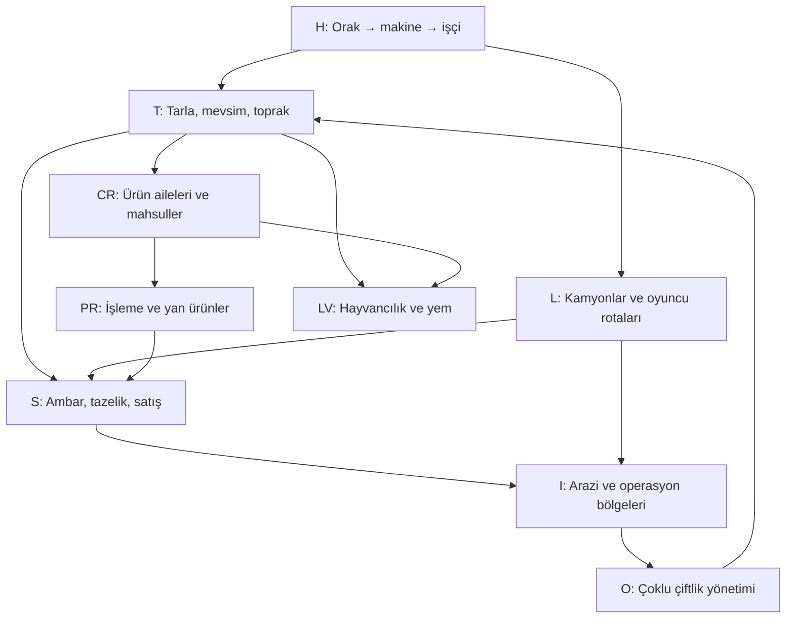

# Kapsamlı teknoloji ağacı — öneri 0.2

Bu belge mevcut [teknoloji ağacı taslağını](./technology-tree-draft.md) genişletir ve açık kalan düğüm ailelerine varsayılan çözüm getirir. Kullanıcı tarafından daha önce seçilmiş mekanikler korunur; yeni içerik seçimleri ve sayısal kapılar bu proje için önerilen tasarım kararıdır. Düğümler veri tabanlı tutulmalı; sonradan ürün eklemek ana ağacın yapısını bozmasın.

## 1. Tasarım ilkeleri

- Ağacı tek uzun zincir değil, aynı anda ilerleyebilen dokuz dal olarak kur: açılış/iş gücü, tarla, ürün aileleri, işleme, filo, depolama/pazar, hayvancılık, arazi/bölgeler, işletme otomasyonu.
- Düğüm kartında aynı sıra kullanılır: **ön koşul → harcanmayan kanıt → para bedeli → açılan kural/izin → ayrıca alınması gereken bina/araç → sonraki düğümler**.
- **Kod ayrımı:** `P1–P10` kilometre taşı kodları ömür boyu üretim kanıtıdır. Fabrika/işleme teknolojilerinin düğüm kodu `PR01–PR46` olarak gösterilir; arayüz bunları farklı rozetlerle ayırır.
- Teknoloji satın alımı ve varlık satın alımı ayrıdır. Bir düğüm fabrikayı kullanma izni verir; fabrikanın kendisi ayrıca alınır.
- P/D/V kanıtları önceki [ekonomi ve ilerleme teklifinde](./economy-and-progression-proposal.md) tanımlıdır. Düğüm açıldığında sayaç tüketilmez.
- Ham satış her açılmış üründe kalıcı seçenektir. İşleme ve yan ürünler zorunlu ilerleme yolu olmaz.
- Kuzey Yarımküre'deki bütün arazi ve bölge seçenekleri başlangıçtan haritada görünür ve nakit yettiğinde satın alınabilir. Arazi sahipliğini teknoloji kapatmaz; yalnızca Güney Yarımküre erişimi ileri teknoloji + ayrı ödeme ile açılır.
- Oyuncu her dalı zamanla açabilir; erken seçim yalnızca sırayı ve nakit akışını etkiler.
- Her ana kapı için ön koşulu hâlâ erişilebilir, birbirinden farklı en az iki alternatif ürün/işletme rotası bulunur. V1’in tahıl+ayçiçeği veya tahıl+patates olması korunur.
- İşçi, araç, fabrika veya ürün kuralı çevrimdışı çalışır. Ayar gerektiren üretim emri ve rota durumu görünür; teknoloji, temel rota seçimini oyuncudan almaz.

## 2. Üst seviye bağlantı haritası

Mevcut H01–H03, T01–T18, L01–L10, S01–S07, I01–I03 ve LV01–LV04 düğümleri temel taslağın ID’leri olarak korunur. Eski `P01–P12` işleme düğümleri kod çakışmasını önlemek için `PR01–PR12` olarak gösterilir. Aşağıdaki satırlar kalan ağaç alanlarını tamamlar. Ürün düğümlerinin tam kataloğu ayrı [ekilebilir ürün ağacında](./crop-tree-and-calendar-proposal.md) yer alır.

## 3. Açılış, emek ve tarla işletimi

| ID / düğüm | Ön koşul | Kanıt / bedel | Açtığı özellik | Sonraki |
|---|---|---|---|---|
| H01 Mini çim biçme makinesi | Orak ve kanca öğreticisi | P0 / 90 ÇK varlık bedeli | Oyuncu makineye biner; hareket hızı ve biçme yarıçapı artar. | H02 |
| H02 İlk işçi | H01 | P0 / 180 ÇK işe alım | Makine işçiye verilir; çim biçme otomatikleşir, kamera yönetim görünümüne geçer. Başlangıç parseli ve ücretsiz ilk tohum verilir. | H03, L01, S01 |
| H03 Tarla mekanizasyonu | H02 | P1 / C1 | Traktör ve temel ekim/hasat ekipmanı satın alma izinleri. Grass satışları P1 kanıtına yazılır. | T01, H04 |
| H04 İş sırası panosu | H03 + T01 | P2 / C2 | Her işçiye ekim, biçim, hasat ve bekleme görevini basit sıra halinde verme. İşçi görevleri çevrimdışı sürer. | H05, T29 |
| H05 İkinci ekip | H04 | P2 / C2 | İkinci tarlaya veya plantasyona paralel iş emri ve işçi atama. | H06, O01 |
| H06 Hasat ekipmanı | H03 + T01 | P2 / C2 | Hasat çevrimini kısaltan ekipman satın alma izni. Tarla başına hız artışı sınırlıdır; ürün takvimini değiştirmez. | H07, T29 |
| H07 Mevsimlik vardiya planı | H04 + T03 | P3 / C3 | Mevsim başlangıcında önceden kaydedilmiş görev dizisini uygular. Uygun ürün yoksa işçi boş bekler; tohum otomatik alımı varsa sipariş verir. | O02, T24 |
| H08 Bakım ekibi | H06 + L01 | P3 + D2 / C3 | Makine duruşu ve araç bakımını otomatik küçük giderle önler; nakit yoksa bakım bekler, borç oluşmaz. | L14, O03 |
| H09 Bölge amiri | I06 + H07 | P6 + D3 / C6 | Bir operatörün çoklu tarla/işçi atamalarını şablondan yönetme. Rota ve tarife kararları oyuncu ayarında kalır. | O04, I09 |
| H10 Operasyon yöneticisi | O05 + I10 | P8 + D4 / C8 | Çoklu bölge panosundan istisna ve kapasite darboğazlarını gösterir; kendi başına yeni rota/ürün seçmez. | O06, O07 |

## 4. Tarım, toprak, iklim ve kapasite teknolojileri

| ID / düğüm | Ön koşul | Kanıt / bedel | Açtığı özellik | Sonraki |
|---|---|---|---|---|
| T07 Hassas sulama | T02 | P3 / C3 | Sulama izni açılır; parsel ekipmanı 0,50 BHB'ye, +0,05 veren iki yükseltme sırasıyla 0,25 ve 0,50 BHB'ye ayrıca alınır. Toplam +0,10'u ve 1,15 uygunluk tavanını aşamaz. Nakit yoksa yükseltme bekler, tarla çalışmayı sürdürür. | T08, T31 |
| T08 Bölgesel çeşit programı | T02 + herhangi bir CR mahsul izni | P3 + CR ürün kanıtı / C3 | Oyuncu bir ürünü ve bölgeyi seçerek program başına 0,25 BHB'ye bir kez satın alınan çeşit uyumu araştırır; +0,05 uygunluk verir. Sulama ve diğer etkilerle toplam tavan 1,15'tir. Ürün/bölge kilidi yaratmaz. | T27, T28 |
| T09 Plantasyon yetiştiriciliği | T25 + V2 | P4 / C4 | Kalıcı meyve bahçesi/plantasyon parseli kurma izni açar; fidan ve plantasyon varlığı ayrıca satın alınır. İlk olgunlaşma 2–4 saatlik oyun süresi hedefidir. Olgunlaştıktan sonra uygun hasat penceresinde tekrar çevrim verir; bitki doğal yaşlanmayla kaybolmaz. Bu kapı ürün hasadı kanıtı istemez; böylece plantasyon açma ön koşulunda döngü oluşmaz. | T10, T12, T27 |
| T10 Budama ve sezon bakımı | T09 | P5 + en az bir plantasyon hasadı / C5 | Plantasyonun isteğe bağlı dönemsel bakım görevini açar. Bakım bedeli ürünün o pencere için beklenen taban hasat değerinin %1'idir. Bakım yapılırsa normal verim korunur; yapılmazsa yalnızca ilgili hasadın verimi %10 azalır, ağaç/bağ kalıcı kalır. | T11, T12 |
| T11 Plantasyon bakım otomasyonu | T10 + H07 | P5 + D2 / C5 | Mevsim başında kayıtlı bakım emrini çevrimdışı uygular. Para yeterliyse bakım ödenir; bakiye yetmezse atlanıp tek hasada %10 etki uygulanır. Borç veya bitki kaybı yoktur. | H09, O03 |
| T12 Fidanlık ve dikim ekibi | T09 + S01 | P5 + D2 / C5 | Fidan stoklama/teminini ve yeni plantasyon varlığı satın alımını açar; dikili bitkiler kalıcı işletme varlığı olur ve arazi satın alımında bahçe parseli olarak görünür. Kurulum süresini kısaltmaz; olgunlaşma dengesi T09 ile aynı kalır. | T27, I05 |
| T19 Geniş tahıl ailesi | T01 + V1 | P2 / C2 | Arpa, yulaf, çavdar, pirinç, sorgum, darı, karabuğday, kinoa, tritikale, tef ve amarant için ayrı CR mahsul düğümlerine dal açar. | CR08–CR14, CR76–CR79 |
| T20 Sebze ailesi | T01 + V1 | P3 + V1 / C3 | Domates, soğan, havuç, biber, salatalık, lahana, yapraklılar, kabakgiller ve diğer sebzeler için ayrı CR düğümlerine dal açar. | CR27–CR42, CR83–CR86, PR45 |
| T21 Geniş baklagil programı | T15 + CR05 veya V2 | P3 + V2 / C3 | T15 ile açılmış nohutun ardından ikinci basamak baklagil mahsullerini görünür kılar. Mercimek, kuru fasulye, bezelye, bakla, börülce, maş ve acı bakla ayrı CR teknoloji/bedeli ister. | CR06–CR07, CR47–CR51, PR21–PR22 |
| T22 Endüstri, kök ve şeker ailesi | T19 + V2 | P4 + V2 / C4 | Şeker pancarı/kamışı, nişastalı yumrular ve lif/endüstri bitkileri için ayrı mahsul düğümlerini başlatır; hiçbir ürün topluca açılmaz. | CR21–CR26, CR72–CR75, PR19–PR20, PR31–PR32, PR41–PR42 |
| T23 Yağ/protein çeşitleri | T05 + V2 | P4 + V2 / C4 | Soya, kanola, yerfıstığı, susam, aspir, keten tohumu, hardal tohumu, kamelina ve chia ürün düğümlerini açar; baklagil ailesi şart değildir. | CR15–CR20, CR80–CR82, PR16–PR18 |
| T24 Yem ve örtü bitkileri | T19 + V2 | P4 + V2 / C4 | Yonca, üçgül, fiğ ve yemlik sorgum için ayrı ürün düğümleri. Yem ürünü hayvan sahibi olmayı gerektirmez; dışarıdan yem alma alternatifi açık kalır. | CR43–CR46, PR44, LV09–LV12 |
| T25 Meyve bahçesi ailesi | T01 + V2 | P4 + V2 / C4 | Elma, armut, şeftali, narenciye, üzüm, zeytin, çilek, yaban mersini, kuruyemiş, ahududu, böğürtlen, kiraz, erik, incir ve nar dallarını başlatır. Aile tüm mahsulleri topluca açmaz. | T09, CR52–CR62, CR87–CR92 |
| T26 Sıcak kuşak plantasyon ailesi | T20 + V3 | P5 + V3 / C5 | Avokado, muz, ananas, kahve, çay, kakao, hurma, hindistan cevizi, yağ palmiyesi, mango, papaya, pitaya ve kaju için ayrı CR düğümlerini açar. Her ürün her bölgede ekilebilir; bölgesel uygunluk hasat değerini değiştirir. | CR63–CR71, CR93–CR96, PR43 |
| T27 Fide ve çeşit programı | T08 + T25 | P5 + 3 bölge / C5 | Meyve/çok yıllı ürünlerin kurulum materyali ve çeşit seçimi. Ürün veya bölge kilidi koymadan yerel verim farkını azaltır. | T12, T28 |
| T28 İklim uyum laboratuvarı | T03 + T08 + V3 | P5 / C5 | Seçilmiş ürünün ekim penceresini bir komşu mevsim genişletir; her ürün için ayrı çalışma izni gerekir. Süresiz tüm-mevsim ekimi vermez. | T30 |
| T29 Hassas tarla araçları | H06 + T02 | P4 + D2 / C4 | Ekim/hasat işçilik süresini %10 azaltır ve parsel/ekipman uyumluluk paneli açar. Hasat miktarını doğrudan ikiye katlamaz. | T31, H07 |
| T30 İklim kontrollü sera | T04 + T28 | P6 + V3 / C6 | Sera mevsimlik ürün çevrimlerini yıl boyu yürütür. Aktif çevrim gideri geçerlidir; sera kalıcı plantasyonun doğal hasat sezonunu silmez. | PR23, I07 |
| T31 Parsel ölçüm ağı | T02 + T29 | P4 / C4 | Toprak durumu, uygunluk ve beklenen hasat miktarını tek harita katmanında gösterir; çok ayrıntılı besin simülasyonu getirmez. | O03, T32 |
| T32 Gübre verimliliği | T31 | P5 / C5 | Otomatik gübrelemenin aynı toprak düzeltmesine giden giderini %20 azaltır. Gübre pahalı/karşılanamazsa üretim yine sürer. | T33 |
| T33 Düşük etkili toprak programı | T32 + V3 | P6 + 3 farklı aile / C6 | Parsel başına toprak düşüşünü yavaşlatır; rotasyon bonusunu veya bölgesel uygunluğu değiştirmez. | — |
| T34 Aromatik bitki ve baharat ailesi | T20 + V3 | P5 + V3 / C5 | Fesleğen, nane, kişniş, kimyon, safran, lavanta, papatya, vanilya ve karabiberi ayrı CR düğümleriyle açar. Ürünler her kuşakta yetiştirilebilir; uygunluk katsayısı bölgeye göre değişir. | CR97–CR105, T35, PR46 |
| T35 Aromatik plantasyonlar | T34 + T09 | P6 + V3 / C6 | Nane, safran, lavanta, vanilya ve karabiberin kalıcı ya da çok yıllı dikim biçimlerini açar. Tesis ve fideler ayrıca satın alınır; ilk olgunlaşma ve tekrar hasadı ürün düğümünde gösterilir. | CR98, CR101–CR102, CR104–CR105 |

Mahsullerin tüm açılma düğümleri, alternatif teknoloji kapıları ve oyun çevrimleri ürün ağacındaki CR kodlarıyla yönetilir. Ürün ailesi düğümü sadece dal iznidir; her ürün ayrı satın alma ve üretim kanıtı ister.

## 5. İşleme ve yan ürün endüstrisi

Tesis ve araçlar teknoloji bedeline dahil değildir; her fabrika satın alınır. Fabrikalar ham ürünü kapatmaz. Oyuncu hasat partilerini ayrı yönlendirir. Tarif önceliği, sabit miktar/üretilebilir azami miktar seçimi ve ortak stok dağıtımı mevcut kullanıcı kararlarıdır.

| ID / düğüm | Ön koşul | Kanıt / bedel | Açtığı dönüşüm veya varlık izni | Sonraki |
|---|---|---|---|---|
| PR01 Mısır unu fabrikası izni | T01 | P2 + mısır üretim kanıtı / C2 | Mısır → mısır unu değirmenini satın alma izni verir; tesis ayrıca alınır. Ham mısır satışını kapatmaz. İleri un/yem/çok girdili tarifler PR08, PR09 ve PR35/LV11 ile sonradan açılır. | PR02, PR03, PR16, PR35 |
| PR02 Değirmen verimliliği | PR01 | P3 / C3 | Fabrika çevrim hızını %15 artırır; girdi başına ürün miktarını değiştirmez. | PR03, PR04 |
| PR03 Ürün tasnifi ve koruma | PR01 veya T04 | P3 + V1 / C3 | Ürün tasnifi/paketleme ve ilk temel koruma reçetelerini açar; fabrika/depo ayrıca satın alınır. | PR04, PR07, PR10, LV03 |
| PR04 İleri gıda işleme | PR02 + PR03 | P4 + V2 / C4 | Tahıl, yağ, baklagil, sebze ve diğer ürünlerde ileri/çok girdili işlem tariflerini açar; ham satış hep korunur. | PR07, PR08, PR09, PR13–PR46 |
| PR05 Ayçiçeği yağı tesisi izni | T13 / CR03 | P3 + ayçiçeği üretimi / C3 | Ayçiçeği → yağ presi satın alma izni; tesis ve taşıma aracı ayrıca alınır. | PR04, PR16–PR18 |
| PR06 Patates nişastası tesisi izni | T14 / CR04 | P3 + patates üretimi / C3 | Patates → nişasta tesisi satın alma izni; tesis ve taşıma aracı ayrıca alınır. | PR04, PR20 |
| PR07 Raf ömrü uzatılmış işleme | PR04 + S05 | P4 + V2 / C4 | Uygun işlenmiş ürünlerde bozulma hızını %50 daha düşürür. Girdi yaşı/kalitesi korunur ve miktar/tarif kabulü değişmez. | S06, PR39 |
| PR08 Alternatif üretim kullanımları | PR04 + V2 | P4 + V2 / C4 | Açılmış ürünlerin ham satışına ek ikinci ve sonraki isteğe bağlı işleme yollarını açar; her tarif/tesis ayrı kalır. | PR09, PR11, PR13–PR46 |
| PR09 Çok girdili tarifler | PR08 + PR03 | P5 + V3 / C5 | Farklı ürün ailelerini kullanan ileri tarifleri açar. Oyuncunun seçtiği tır rotaları girdileri taşır; tarif sırası çevrimdışı işler. | PR11, PR34–PR38, LV11 |
| PR10 Yan ürün değerlendirme | PR03 + P3 + V2 | P5 + V2 / C5 | Yan ürünler otomatik satılır; teknoloji sonrası oyuncu bunları depolayıp başka hatta yönlendirebilir. Yan ürün ana ilerlemeyi veya depo doluluğunu kilitlemez. | PR36 |
| PR11 Esnek üretim emirleri | PR08 veya PR09 + L04 | P5 + D3 / C5 | Tarif önceliği ile sabit miktar/üretilebilir azami miktar hedefini açar. Her parti sonrası emir yeniden değerlendirilir; sürekli tüketilen üst sıradaki tarif altları bekletebilir. | PR38, O05 |
| PR12 Nohut unu tesisi izni | T16 / CR05 | P3 + nohut üretim kanıtı / C3 | Nohut → nohut unu tesisini ayrıca satın alma izni; ham nohut satışı devam eder. Bu ürünün ilk isteğe bağlı işleme rotasıdır. | PR04, PR08, PR22 |
| PR13 Buğday değirmeni | CR01 | P2 + buğday üretimi / C2 | Buğday → un; ayrı değirmen alınır. | PR04 |
| PR14 Pirinç değirmeni | CR11 + PR04 | P4 + pirinç üretimi / C4 | Pirinci kabuk ayırma ve öğütme; kepek varsayılan otomatik satılır. | PR10, PR35 |
| PR15 Tahıl işleme | T19 + PR04 | P4 + 2 tahıl / C4 | Arpa → malt/irmik; yulaf → ezme; çavdar → un; pirinç dışındaki sorgum, darı, karabuğday, kinoa, tritikale, tef ve amarant → ürüne özgü un/tane tarifleri. Her tarif bağımsız emir olur. | PR35, PR38 |
| PR16 Soya kırma hattı | CR15 + T23 | P4 + soya üretimi / C4 | Soya → yağ + küspe. Küspe PR10 açılana kadar otomatik satılır. | PR10, PR28 |
| PR17 Kanola, aspir ve özel tohum presi | T23 + PR08 + CR16, CR19, CR20, CR80, CR81 veya CR82 | P4 + ilgili mahsul / C4 | Kanola, aspir, keten tohumu, hardal tohumu, kamelina ve chia → yağ/ürüne özgü tohum çıktısı + küspemsi yan ürün. Keten sapının lif hattı PR32'de ayrı çalışır; ürün tarifleri ayrı açılır. | PR10, PR28, PR32 |
| PR18 Yerfıstığı/susam presi | CR17 veya CR18 + PR08 | P5 + ilgili üretim / C5 | Yağ ve kavrulmuş/ezme ürün seçenekleri. | PR10, PR35 |
| PR19 Şeker fabrikası | CR21 veya CR22 + PR04 | P5 + V2 / C5 | Şeker pancarı/şeker kamışı → şeker; posa/bagasse otomatik satış. | PR10, PR36 |
| PR20 Manyok nişastası | CR23 + PR06 | P5 + manyok üretimi / C5 | Manyok → tapyoka/nişasta. | PR10, PR35 |
| PR21 Baklagil tasnif ve paketleme | T21 + PR03 | P4 + 2 baklagil / C4 | Kuru baklagilleri daha uzun raf ömürlü paketli satışa çevirir; yaş sıfırlanmaz. | PR22, PR35 |
| PR22 Baklagil unu/konservesi | PR21 + CR05 | P5 + nohut üretimi / C5 | Nohut unu ile mercimek/fasulye konservesi gibi ayrı ürün hatları. | PR35, PR38 |
| PR23 Sebze paketleme merkezi | T20 + PR03 | P4 + 3 sebze / C4 | Yıkama, boylama, paketleme; ayrı soğuk/normal ürün stoğu yaratır. | PR24, PR25 |
| PR24 Sebze kurutma ve dondurma | PR23 + S05 | P5 + V2 / C5 | Yapraklılar, soğan, biber ve diğer uyumlu sebzelerde kurutma veya dondurma seçenekleri. | PR35, S14 |
| PR25 Domates/konserve hattı | CR27 + PR23 | P5 + domates üretimi / C5 | Domates → püre/sos/konserve; fazla ürün kurtarma yolu. | PR35, PR38 |
| PR26 Meyve suyu/kurutma | T20, T25 veya T26 + PR03 | P5 + 2 meyvemsi ürün kanıtı / C5 | Karpuz/kavun, elma, armut, şeftali, narenciye, ahududu, böğürtlen, çilek, yaban mersini, incir, nar, muz, ananas, mango, papaya, pitaya ve hurma gibi ürüne özel meyve suyu, kurutma veya koruma tarifleri. Üzüm ve zeytinin özel hatları PR27'dedir. | PR27, PR35 |
| PR27 Zeytin ve üzüm işleme | CR58 veya CR57 + PR26 | P5 + ürün kanıtı / C5 | Zeytin → sofralık zeytin/yağ; üzüm → kuru üzüm/su. Ürün adları ayrı pazarda kalır. | PR35 |
| PR28 Kuruyemiş ve kakao | T25 veya T26 + PR08 | P6 + ilgili mahsul / C6 | Badem/ceviz/kaju kavurma veya ezme; kakao çekirdeği → kakao ürünü. Avokado püre/yağı PR43'te; yan ürün varsayılan otomatik satılır. | PR10, PR35 |
| PR29 Kahve kavurma | CR66 + PR03 | P6 + kahve üretimi / C6 | Kahve çekirdeği kurutma/kavurma/paketleme. | PR35 |
| PR30 Çay işleme | CR67 + PR03 | P6 + çay üretimi / C6 | Çay yaprağı soldurma, kurutma ve paketleme. | PR35 |
| PR31 Pamuk çırçır | CR72 + PR04 | P5 + pamuk kanıtı / C5 | Pamuk → lif + çekirdek; çekirdek otomatik satılır, sonra yağ hattına girebilir. | PR10, PR32 |
| PR32 Lif ve tekstil | (PR31 + CR72) veya (CR20/CR73/CR74 + PR08) | P6 + 2 lif ürünü / C6 | Pamuk lifi PR31'den; keten/kenevir/jüt lifi kendi temizleme hattından gelir. İki farklı lif kaynağıyla iplik/kumaş açılır; pamuk kullanmak zorunlu değildir. | PR35 |
| PR33 Süt işleme | LV05 veya LV08 + PR03 | P5 + hayvansal ürün / C5 | Keçi/inek sütü → pastörize/paketli süt. | PR34, PR35 |
| PR34 Peynir ve tereyağı | PR33 + PR09 | P6 + V3 / C6 | Sütlü ürünler için çok girdili işlem. | PR35 |
| PR35 İleri çok girdili ürünler | PR09 + V3 | P6 + 4 aile / C6 | Un, yağ, süt, sebze, yumurta veya meyve gibi kaynaklardan çok girdili tarifler. | PR36, PR38 |
| PR36 Yan ürün reçete ağı | PR10 + T24 + 3 yan ürün | P6 / C6 | PR10 ile açılmış depolama/yönlendirmenin üstüne, küspe, kepek, posa ve sap için yem/enerji/kompost gibi isteğe bağlı dönüşüm tarifleri açar. Yeni depolama kontrolü veya zorunlu toprak mikro yönetimi eklemez. | LV11, PR37 |
| PR37 Kaba yem ve organik geri dönüşüm | PR36 + T24 | P7 + V3 / C7 | Bitki artığı/yan ürünü isteğe bağlı hayvan yemine veya düşük değerli komposta çevirir; toprak mikro yönetimi oluşturmaz. | LV11, T33 |
| PR38 Üretim emri optimizasyonu | PR11 + D3 | P6 + D3 / C6 | Tarif sırası, sabit miktar veya azami üretim modu, eşik stok ve ortak stok dağıtımı. | L09, O05 |
| PR39 Fabrika kalite kontrolü | PR35 + S07 | P7 / C7 | Girdi kalite/yaşına göre tahmini çıktı değerini ve raf ömrünü gösterir; kaliteyi geri almaz. | S15 |
| PR40 Kapalı döngü üretim | PR37 + L08 + S06 | P8 + 3 bölge / C8 | Seçilmiş sabit ürün ağacında atık/yan ürün minimizasyonu; oyuncu isterse kapatabilir. | O07 |
| PR41 Kök ve yumru işleme | T22 + CR24–CR26 + PR08 | P5 + ilgili ürün kanıtı / C5 | Tatlı patates, yam ve taro için ayrı nişasta, püre ve kurutma tariflerini açar; patates veya manyok fabrikası ön koşul değildir. Tesis ve taşıma aracı ayrıca alınır. | PR35, PR38 |
| PR42 Endüstriyel yaprak kurutma | CR75 + PR08 | P7 + tütün üretimi / C7 | Tütün yaprağını kontrollü kurutup endüstriyel hammaddeye dönüştürür; hammaddeyi satmak/işlemek isteğe bağlıdır. Tüketim ürünü veya ana ilerleme şartı değildir. | PR35 |
| PR43 Tropik yağ ve lif ürünleri | T26 + PR08 | P7 + CR63 veya CR70/CR71 üretim kanıtı / C7 | Avokado → püre/yağ; hindistan cevizi → yağ/süt/lif; yağ palmiyesi → palm yağı/çekirdek küspesi tariflerini açar. Yan ürün PR10 öncesi otomatik satılır; fabrika ayrıca alınır. | PR10, PR35, PR36 |
| PR44 Kaba yem hazırlama | T24 + PR03 | P5 + 2 yem ürünü / C5 | Yonca, üçgül, fiğ ve yemlik sorgumu balyalama, pelet veya silaj ürününe dönüştürür; ahıra taşıma oyuncunun rotasında kalır. | LV09–LV12, PR36 |
| PR45 Turşu ve fermantasyon | T20 + PR23 + PR08 | P5 + 2 sebze kanıtı / C5 | Lahana, salatalık, biber, pancar ve uyumlu sebzelerden ayrı turşu/fermente ürün tarifleri açar. Ürünler ham satılabilir; fabrika stoğu/taşıması ayrıca gerekir. | PR35, PR38 |
| PR46 Baharat ve aromatik işleme | T34 + PR08 | P5 + 2 aromatik ürün kanıtı / C5 | Uygun yaprak/tane/çiçek ürünleri için kurutma, öğütme, paketleme veya kurgusal özüt tarifleri açar. Her ürünün tarifi/tesis izni ayrı kalır; ham satış kapanmaz. | PR35, PR38 |

## 6. Filo ve oyuncu kontrollü lojistik

| ID / düğüm | Ön koşul | Kanıt / bedel | Açtığı özellik | Sonraki |
|---|---|---|---|---|
| L11 Römork ve çoklu gövde | L02 + D2 | D2 / C3 | Hafif römork, kuru dökme gövde ve soğutuculu gövdeyi ayrı satın alma seçeneği. | L12, L13 |
| L12 Dökme ürün kasası | L07 + L11 | D3 + P3 / C4 | Tahıl/şeker pancarı gibi dökme yükte daha hızlı yükleme ve yüksek kapasite. | L15 |
| L13 Modüler soğutucu kasası | L08 + L11 | D3 + P3 / C4 | Aynı şasiye uygun soğuk kasa takma; tazelik etkisi S05/L05’e bağlı. | L16 |
| L14 Filo bakımı | H08 + L04 | D3 / C3 | Sefer sonu küçük otomatik bakım gideriyle hız/kapasite kaybı oluşmasını önler. Nakit yetmezse performans cezası değil bekleme vardır. | L17 |
| L15 Toplu yükleme noktası | L12 + S08 | D3 + P4 / C4 | Tahıl silosu/işleme tesisinde yükleme süresini azaltır. | I02, L17 |
| L16 Soğuk sevkiyat planı | L13 + S05 | D3 + P4 / C4 | Rota kartında tahmini kaliteyi ve varış değerini gösterir; rota seçimini oyuncu yapar. | L18 |
| L17 Filo grupları | L14 + L15 | D4 / C5 | Araçları ürün/rota/operasyon bölgesine göre gruplandırır ve grup ayarını kopyalar; kendi kendine güzergâh uydurmaz. | L18, O04 |
| L18 Çok bölge rota planı | I07 + L17 | D5 + 2 bölge / C7 | Bölgeler arası oyuncu tarafından belirlenen rotalar, sefer zamanı tahmini ve merkez aktarması. | O06 |

## 7. Depo, satış, piyasa ve kalite

| ID / düğüm | Ön koşul | Kanıt / bedel | Açtığı özellik | Sonraki |
|---|---|---|---|---|
| S03 Tazelik takibi | S01 + L01 | P2 + D1 / C2 | Her parti için yaş, tahmini kalite, kayıp eşiği ve varış değeri görünür. Temel kalite kuralını veya FIFO'yu değiştirmez. | S05, S07, L10 |
| S05 Koruyucu depolama | S03 + S01 | P3 / C3 | Ayrıca alınan depo/ambarda seçili ürünlerin bozulma hızını %50 azaltır; ürün yaşı sıfırlanmaz. | S06, S07, S14 |
| S06 Tam tazelik muhafazası | S05 + S14 + L08 | P7 + D4 / C7 | Ayrıca alınan kontrollü depo, seçili ürünleri depoda tutulduğu sürece bozulmadan saklayabilir. Aktif soğuk muhafaza gideri günlük beklenen parti değerinin %2'sidir; kapasite ve gider seçime göre görünür. Taşıma sırasında S06 çalışmaz; parti yaşı/kalitesi silinmez ve depodan çıkınca normal bozulma sürer. | S15, O05 |
| S07 Parti tazelik analizi | S03 + S05 | P3 + D2 / C3 | Toplam stok altında parti yaşını, FIFO sırasını, tahmini satış değerini ve kaybolmaya kalan süreyi gösterir. | S14, S15, L10 |
| S08 Tohum ambarı | S01 + T01 | P2 / C2; ambar ayrıca alınır | Tohumları stoklama ve fiyat düşükken alım; X/Y eşikleri ürün başına kullanıcı ayarı. | S09 |
| S09 Akıllı tohum siparişi | S08 | P2 / C2 | X/Y eşiğine göre otomatik sipariş; varsayılan X bir ekim, Y iki ekim. Para yoksa alınabilen kadar alır, borç yok. | O02 |
| S10 Kuru tahıl silosu | S01 + CR01/CR02 | P3 / C3 | Tahıl kapasitesini artırır ve parti bozulmasını yavaşlatır; bina ayrıca alınır. | L12, S13 |
| S11 Soğuk oda | S01 + PR03 | P3 + D2 / C3 | Yumurta, süt, taze sebze ve meyvede bozulma hızını yarıya indirir. | S14, L05 |
| S12 Pazar ekranı | S02 | P2 / C2 | Ürün taban fiyatı, bölgesel arz, geçen fiyat ve gelecek eğilim tahmini. | S13, O03 |
| S13 Uzun dönemli depo | S10 + S12 | P4 / C4 | Büyük ambar satın alma izni, parti yaşlarının toplam görünümü ve kapasite tahmini. | S14, I02 |
| S14 Kontrollü atmosfer | S11 + L05 | P5 + D3 / C5 | Seçilmiş bozulabilir ürünlerde raf ömrü hızını %75 azaltır; yaş sıfırlanmaz. | S15 |
| S15 Parti değer tahmini | S07 + PR39 | P6 + D3 / C6 | Parti/FIFO/rota bazında varışta tahmini satış değeri ve kayıp zamanını gösterir. | O05 |
| S16 Toplu satış anlaşması | S04 + S12 | D3 + P4 / C4 | Son tarihli, isteğe bağlı bonuslu sözleşme. Süre aşımı cezasız; ana ilerleme için şart olmaz. | S17 |
| S17 Bölge pazar erişimi | I06 + S16 | P6 + D4 / C6 | Farklı operasyon bölgesindeki satış tabanına erişim. Düşük pazar talebi taban fiyatı %78’in altına çekemez. | L18, O06 |

## 8. Arazi ve çoklu operasyon bölgeleri

| ID / düğüm | Ön koşul | Kanıt / bedel | Açtığı özellik | Sonraki |
|---|---|---|---|---|
| I03 Bölgesel iş panosu | I02 + I04 | P5 + D3 + V2 / C5; yönetim merkezi ayrıca alınır | Oyuncunun zaten sahip olabildiği uzak çiftliklerde işçi/araç atamalarını, rota saatlerini ve istisnaları tek ekranda yönetmesini sağlar. Arazi, iklim bölgesi veya çiftlik satın alımını açmaz ya da kapatmaz. | I05, I06, S17 |
| I04 Parsel kârlılık tahmini | T01 + S01 | P2 / C2 | Başlangıç haritasında zaten görünen bütün Kuzey Yarımküre arazilerine ürün uygunluğu, bedel ve tahmini hasat/gelir projeksiyonu ekler. Haritayı gösterme ve satın alma izni bu teknolojiden bağımsızdır. | I03, I05 |
| I05 Toprak/uygunluk atlası | I04 + T31 | P3 / C3 | Toprak ve ürün uygunluğu katmanını detaylandırır, açılmış her mahsulde hasat tahminini yeniler; sahiplik kuralı getirmez. | I06, T08 |
| I06 Çoklu işletme yönetimi | I03 + PR04 | P6 + D4 + V3 / C6 | Mevcut uzak operasyonlar için filo/işçi grupları, görev şablonları ve birleşik kapasite raporu açar. Yeni arazi almak için teknoloji şartı koymaz; her mülk kendi nakit bedeliyle satın alınır. | I07, S17, H09 |
| I07 İkinci yarımküre erişim izni | I06 + P7 | P7 + D4 + V3 / C7 + 75 BHB erişim bedeli | Güney yarımkürede harita/bölge satın alma iznini açar; satın alınan bölgeler yerel 9 saat mevsim fazını izler. | I08, L18 |
| I08 Kıtalar arası işletme | I07 + L18 | P8 + D5 / C8 | Birden çok yarımküre/operasyon bölgesinde çiftlik kurup mevcutları koruma. Reset/prestij yoktur. | I09 |
| I09 Bölge yöneticisi | I08 + H09 | P8 + V4 / C8 | İşçi ve tesis emri şablonlarını bölgeye kopyalar; rota durakları ve ürün rotasyonu oyuncu onayında kalır. | O06, O07 |
| I10 Ana işletme merkezi | I08 + D5 | P9 / C9 + bina | Tüm bölgeler için nakit, stok, teslimat, ürün ve istisna paneli. Yeni bölge satın alımını otomatik yapmaz. | H10, O07 |
| I11 Bölge geliştirme paketi | I06 + PR35 | P7 + 3 ürün ailesi / C7 | Yeni bölgeye başlangıç yolu, küçük ambar ve servis alanı satın alma paketi; ücretsiz arazi vermez. | I12 |
| I12 Çiftlik şablonları | I09 + I10 | P9 + D5 / C9 | Oyuncu belirlediği parsel yerleşimi, fabrika/rota preset’lerini kopyalama; yeni bölgede uyumsuz varlıklar ayrıca uyarılır. | O07 |

**Arazi erişimi ve ikinci yarımküre:** Kuzey Yarımküre'deki arazi ve bölge seçenekleri en baştan haritada listelenir; oyuncu uygun gördüğü yeri ekonomisi elverince alır. I03/I06 yalnızca birden çok uzak işletmeyi yönetmek için araçlar sağlar, arazi erişimini kilitlemez. Güney Yarımküre için ayrıca P7/D4/V3, C7 ve 75 BHB erişim bedeli gerekir. Arazi/tesis satın alımı ayrı ödemedir; yeni çiftlik önceki işletmeleri silmez.

## 9. Hayvancılık, yem ve veterinerlik

Önerilen sıra: tavuk → keçi ve arıcılık → koyun → süt ineği. İlk hayvan tavuk ve yumurta olmaya devam eder. Hayvan ölümü/borç yoktur; uzun yem kesintisi performansı azaltır, veteriner masrafı çıkarabilir. Hazır yem tedarikçisi her zaman oyuncu filosu dışında hizmet verir ve kendi yeminden pahalıdır.

| ID / düğüm | Ön koşul | Kanıt / bedel | Açtığı özellik | Sonraki |
|---|---|---|---|---|
| LV05 Keçi çiftliği | LV04 + V2 | P4 + 2 ürün ailesi / C4 | Keçi sütü ve yavru/yenileme döngüsü; yem tedarikçisi bağımsız. | PR33, LV11 |
| LV06 Arı kovanı | T20 + S01 | P4 + V2 / C4 | Bal ve balmumu ham satış; kovan ayrı satın alınır, tarla alanını tüketmez. | PR33, PR36 |
| LV07 Koyun çiftliği | LV04 + T24 | P5 + V2 / C5 | Yün ve isteğe bağlı süt; yem tedarikçisi veya kendi yem hattı. | PR32, LV11 |
| LV08 Süt sığırı | LV05 + LV07 | P6 + V3 / C6 | Süt üretimi ve ileri yem tüketimi. Hayvan kaybı yoktur; uzun kesinti yalnız verimi düşürür ve veteriner vakası açabilir. | PR33, LV10, LV12 |
| LV09 Kaba yem ekimi | T24 + LV01 | P4 + V2 / C4 | Yonca/silaj/örtü ürünü yem kaynağı. Hasat edilen yem hayvan hattına tırla taşınır. | LV10, LV11 |
| LV10 Yem silosu | S08 + LV09 | P4 + D2 / C4 | Kuru/silaj yem stoğu ve 2 gerçek saatlik başlangıç tamponu. | LV11, LV12 |
| LV11 Karma yem fabrikası | LV09 + PR09 | P5 + V3 / C5 | 2–3 üründen yem tarifi. Hammadde dışarıdan alınabilir; kendi üretim maliyeti düşürür. | LV12, PR37 |
| LV12 Yem kontrolü | LV10 | P5 / C5 | Oyuncu stok hedefi/otomatik tedarik eşiğini belirler; aksayan tır veya alım bekleme raporu verir. | O05 |
| LV13 Veteriner kliniği | LV05 veya LV08 + LV10 | P5 + V3 / C5; bina ayrı | Uzun yem eksikliğinde oluşan veteriner vakasını tek seferlik nakit masrafla anında kapatır; borç ve ölüm yok. | LV14 |
| LV14 Hayvan bakım planı | LV13 + H07 | P6 / C6 | Yem/kümes kontrolünü çevrimdışı sürdürür; bakiye yem alımını karşılamazsa tedarik bekler, hayvanlar yaşamaya devam eder. | LV15 |
| LV15 Yumurta tasnifi | LV01 + PR03 | P4 + D2 / C4 | Ham yumurtaya ek paketli/tasnifli yumurta. | PR35 |
| LV16 Süt toplama rotası | LV08 + L05 | P6 + D3 / C6 | Sütü çiftlikten işleme hattına soğutuculu rotayla taşır; kalite tahmini gösterilir. | PR33, L16 |
| LV17 Arı ve bahçe sinerjisi | LV06 + T25 | P6 + V3 / C6 | Meyve/plantasyon hasadına küçük, kapaklı polinasyon bonusu; bölgesel uygunluğu değiştirmez. | T27 |
| LV18 Hayvan işletme grupları | LV14 + I09 | P8 + 3 hayvan ürünü / C8 | Çok bölgeli kümes/ahır emirlerini kopyalama; otomatik tür satın alma veya kesim yoktur. | O07 |

## 10. Çiftlik yönetimi ve otomasyon

| ID / düğüm | Ön koşul | Kanıt / bedel | Açtığı özellik |
|---|---|---|---|
| O01 Kayıtlı iş şablonları | H05 + T01 | P3 / C3 | Oyuncu görev sırası ve ürün rotasyonunu şablon kaydedip parsel kopyalayabilir. |
| O02 Mevsim değişimi denetimi | H07 + S09 | P3 / C3 | Gelecek sezon mahsul, tohum stoğu ve satın alma maliyetini önden gösterir. Sezon kararı mevcut kayda göre işler. |
| O03 Hasat/zemin raporu | T31 + S12 | P3 / C3 | Toprak, uygunluk, beklenen ürün miktarı ve pazar fiyatını panelde birleştirir. |
| O04 Filo darboğaz raporu | L17 + S13 | D4 / C4 | Hangi hatta araç hacmi/süresi yetmiyor tahmin eder; rota değişikliği öneri olarak kalır. |
| O05 Üretim planlayıcısı | PR38 + LV12 | P6 + V3 / C6 | Ortak hammadde, stok hedefi, yem ve fabrika tarifleri arasındaki açıkları listeler; değişiklik oyuncu onayında. |
| O06 Çoklu çiftlik raporu | H10 + I10 | P9 + D5 / C9 | Bölgeleri karşılaştırır; kâr, toprak, tazelik, rota ve kapasite özetini tek panelde verir. |
| O07 İşletme kopyalama | I12 + O06 | P10 + 3 bölge / C10 | Oyuncunun seçtiği tarla/fabrika/rota şablonunu yeni bölgeye uygular; ürün ve arazi satın alımını otomatik yapmaz. |

## 11. Oyuncuya gösterilecek düğüm kilit durumu

- **Kilitli:** eksik üst düğümler ve kalan P/D/V sayacı ayrı gösterilir; kanıt sayacı harcanmaz.
- **Satın alınabilir:** bir defalık teknoloji fiyatı, açılacak izin ve varlığın ayrı bedeli gösterilir.
- **Etkin:** düğümün üretim/rota üzerindeki etkisi ve açtığı bağlı düğümler gösterilir.
- Sayı eşiklerine takılan oyuncu aynı P sayaçlarına dahil edilen ham satış, sözleşme, farklı ürün, temel tarla ve fabrika yollarını görür. Alternatif yolların hepsi aynı ekonomik düzeyde olmak zorunda değildir ama en az bir tanesi teknoloji ağacını baştan sona tamamlamaya yeter.
- Her rota ve üretim hattında eksik tohum, nakit, depo, girdi, mevsim, tır kapasitesi veya kalite engeli metinle açıklanır; sessizce üretim kaybolmaz.

## 12. Bu öneriyle cevaplanan açık teknoloji soruları

| Önceki açık soru | Bu taslakta önerilen cevap |
|---|---|
| Başlangıç nakdi ve ilk takas | Başlangıç nakdi 0; kanca geliri mower/işçiyi aldırır; ilk takas kamyon + 750 ÇK verir. |
| Teknoloji fiyatları ve P/D kanıtları | C0–C10, P1–P10, D1–D6, V1–V5 tabloları ekonomi belgesinde. |
| Başlangıç satın alımları | Mini mower ve işçi ilk alınanlar; ilk kamyon takasla; traktör, depo ve fabrikalar izin + varlık bedeliyle. |
| Araç farkları | Hızlı/hafif, temel, ağır/yüksek hacimli, soğutuculu; yakıt otomatik küçük pay, yakıt mikro yönetimi yok. |
| Sonraki hayvanlar | Keçi, arı, koyun, süt sığırı sırası; hayvan kaybı yok. |
| İkinci yarımküre | P7 + D4 + V3, C7 ve ayrıca 75 BHB izin ödemesi. |
| Ağaç derinliği | Tarla/iklim, her ürün ailesi, işlemeler, filo, depo, hayvan, bölge ve işletme yönetimi birbirine bağlandı. |

## 13. Benzer oyunlardan alınan tasarım dersleri

Bu oyunların içerikleri veya ekonomileri kopyalanmıyor; yalnızca sistem örüntüleri tasarım kararlarını sınamak için kullanılıyor.

| Referans | Oyunda görülen örüntü | Bu tasarıma uygulanan karar |
|---|---|---|
| Farming Simulator 22/23/25 | Mevsime bağlı ekim takvimi, satın alınabilir üretim tesisleri, çok girdili fabrikalar, ürünü otomatik satma veya başka noktaya taşıma, büyük lojistik hatları. | Oyuncunun açıkça çizdiği kamyon rotaları ve ayrı fabrika yatırımı; otomatik yükleme/boşaltma ve kapalıyken üretim. Sezon kaçırma hasadı yok etmek yerine oransal kısmi ürüne dönüşür. ([GIANTS — FS22 production chains](https://www.farming-simulator.com/newsArticle.php?country=si&lang=en&news_id=248), [GIANTS — FS23](https://www.farming-simulator.com/about.php?game=fs23&platform=switch)) |
| Hay Day | Seviye/ilerleme ile açılan, oyun parasıyla ayrıca alınan fabrikalar; fabrika ustalığı; tamamlanabilir kamyon siparişleri. | Teknoloji ve varlık iki ayrı satın alımdır; fabrika verimliliği ayrı teknoloji olabilir. Görev/sözleşme bonusu isteğe bağlıdır ve süresi geçince ceza doğurmaz. ([Supercell Support — production buildings](https://support.supercell.com/hay-day/en/articles/production-building.html), [truck orders](https://support.supercell.com/hay-day/en/articles/truck-orders-2-2.html)) |
| Idle Farming Empire | Çevrimdışı üretim ve otomasyon temel ilerleme vaadidir; bazı idle oyunlarda prestij/reset döngüsü de bulunur. | Çevrimdışı üretim korunur; geçici kalite kaybı ve taşıma darboğazı hafif geri dönüş hatırlatıcısı olur. Reset/prestij yoktur; açılan çiftlikler ve filo kalıcı kalır. ([Google Play — Idle Farming Empire](https://play.google.com/store/apps/details?id=com.futureplay.boots)) |

**Tasarım sonucu:** Genişlik ürün aileleri ve bölgesel uygunluktan; derinlik tarif önceliği, depo, kamyon kapasitesi ve oyuncu rotalarından; uzun dönem motivasyonu ise yeni işlemler ve kalıcı operasyon bölgelerinden gelir. Üretim hatları kendi kendine çalışırken oyuncu yalnızca anlamlı yatırım, sıra ve rota kararları verir.

## Kaynaklar ve tasarım sınırı

Gerçek ürün takvimleri için ürün ağacı belgesindeki FAO Crop Calendar, ulusal tarım otoriteleri ve üniversite/uzatma kaynakları kullanılır. Teknoloji/ekonomi ağacı ise oyuna ait tasarım kararıdır; gerçek çiftlik teknolojilerinin eksiksiz simülasyonu olduğu iddia edilmez. Benzer oyunlardan alınan yapısal dersler; oyuncuya görünür üretim hatları, yükseltmeler, koleksiyon/amaç ve çevrimdışı otomasyonla sınırlıdır. *Find The Needle*’dan yalnızca bağımlılık ağacı arayüzü örnek alınır.
